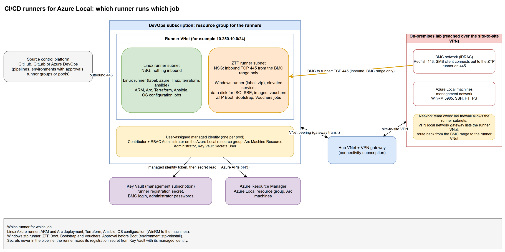

# CI/CD infrastructure: deploy the runners and the pipelines

This is the working guide for [automation / 01-cicd-infra](https://azurelocal.cloud/) (tasks 01 to 06) as the toolkit implements it. It covers the project, its settings and environments, the Azure sign-in, and the self-hosted runners, for GitHub, GitLab and Azure DevOps. You can run each part by hand from a workstation, or from a pipeline. What the toolkit did and did not have before is in the [audit](cicd-infra-audit.md).



The diagram source is [`diagrams/cicd-infra-runners.drawio`](diagrams/cicd-infra-runners.drawio).

## Which runner for which job

| Job | Runner | Why |
| --- | --- | --- |
| Terraform plan and apply, ARM and Bicep deployment, Arc, Azure CLI and Az PowerShell work | **Linux Azure runner** (labels `azure`, `linux`, `terraform`, `ansible`) | It sits next to the Azure control plane and reads secrets with its managed identity. |
| OS configuration (`Invoke-AzlNodeConfiguration` and the Ansible playbooks) | **Linux Azure runner** | It reaches the machines' management addresses over the VPN: WinRM 5985, PowerShell remoting, SSH. |
| azurelocal-ztp Boot, Bootstrap and Vouchers (`Invoke-ZtpEnvironment.ps1`) | **Windows runner with the `ztp` label** | The BMC's SMB client connects out to the runner on TCP 445, and the Boot stage creates an SMB share, a local account and a firewall rule with Windows commands. The service must be elevated. |
| Any job that must not wait on the lab network | A hosted runner | No lab access, no secrets of the lab. |

Keep the `ztp` pool separate: its service has administrator rights and reaches the BMC network. Put an approval in front of the Boot stage, which reinstalls the machines (environment `ztp-reinstall`).

## What you need first

### Network (cross-team work)

The runners live in an Azure VNet that has to reach the lab. The module creates the VNet, its subnets, the NSG and the spoke half of the hub peering. Three things need the network team and are not done by Terraform in the lab:

| Item | Owner | What to ask for |
| --- | --- | --- |
| Hub peering, hub half | Connectivity subscription owner | Either let the module create it (`hub_peering.create_hub_side = true`, needs rights on the hub VNet) or have them create it with gateway transit on. |
| Routes over the tunnel | Network team | The VPN local network gateway for the lab lists the **runner VNet range** as an on-premises-facing prefix, so the lab can answer. With BGP, advertise it. |
| Lab firewall | Network team | Allow the runner subnets to the management network (WinRM 5985, SSH 22, HTTPS 443), to the BMC network (HTTPS 443), and allow the **BMC range to the ZTP runner subnet on TCP 445**. The runner subnet range is the source or destination of every rule. |

What the NSG on the runner subnets allows:

| Direction | Rule | Applies to |
| --- | --- | --- |
| Inbound | Deny from the internet | All runners |
| Inbound | TCP 445 from `bmc_cidrs` only | The `ztp` runner |
| Inbound | SSH 22 or RDP 3389 from `admin_source_cidrs` | Only when you list ranges (default none) |
| Outbound | Azure platform address, HTTPS to `AzureCloud` and the internet (platform, package and runner downloads), HTTP 80 (package mirrors) | All runners |
| Outbound | `reachable_tcp_ports` (default 22, 443, 445, 3389, 5985, 5986) and ICMP to `reachable_cidrs` and `bmc_cidrs` | All runners |
| Outbound | Deny everything else | All runners |

Azure no longer gives new subnets default outbound access. The module keeps it on (`default_outbound_access_enabled = true`) so the runners reach the platform without a NAT gateway. Replace it with a NAT gateway or a firewall route when you have one.

### Identity and roles

Each runner pool has its own user-assigned managed identity. It signs in to Azure as that identity (`-UseManagedIdentity` for ZTP, `az login --identity`, or `ARM_USE_MSI`). Nothing is a secret.

| Where | Role | Variable | Why |
| --- | --- | --- | --- |
| The Azure Local resource group (and, if it can take deployments, its managed-resources group) | Contributor | `contributor_scopes` | Deploy and configure the cluster resources. |
| The Azure Local resource group | Role Based Access Control Administrator | `rbac_administrator_scopes`, optionally limited by `rbac_administrator_delegable_role_ids` | The Azure Local deployment and simplified provisioning assign roles. Microsoft's prerequisite grants it without a limit; the ABAC list narrows it. |
| The Azure Local resource group | Azure Connected Machine Resource Administrator | `arc_machine_scopes` | Arc Run Command on the machines. |
| The registration vault, and the vaults of the BMC login and the administrator passwords | Key Vault Secrets User | `registration_secret.key_vault_id`, `key_vault_reader_ids` | Read the runner's registration secret and the lab secrets at run time. |
| The Terraform state storage account | Storage Blob Data Contributor | (grant it to the pipeline identity) | Only the identity that runs Terraform needs it, not the runners. |
| Any other scope | Any built-in role | `additional_role_assignments` | For anything else. |

The pipeline identity (the app registration of task 01) needs Contributor and User Access Administrator on the subscriptions, as the automation page says, or narrower roles you choose in `devops.authentication.roles`. With OIDC it holds no secret.

### Secrets: what to create by hand

| What | Where | Who |
| --- | --- | --- |
| The runner registration credential | A Key Vault secret named in `devops.runners[].registration_secret` | A person with rights on the platform and the vault |
| GitHub: a PAT or GitHub App token that can create self-hosted runner registration tokens (organization administration: self-hosted runners) | Same secret, `kind = "pat"` (default) | Organization owner |
| GitLab: a runner authentication token (`glrt-...`), created for the project or group with the tags you want (GitLab fixes tags at creation) | Same secret | Project maintainer |
| Azure DevOps: a PAT with Agent Pools (read, manage), and the agent pools named by `devops.runners[].pool` (one for the general runner, its own for the ztp runner; there is no default pool) | Same secret | Pool administrator |
| A platform token with administrator rights for tasks 02 to 05 | `GH_TOKEN`, `GITLAB_TOKEN`, `AZURE_DEVOPS_EXT_PAT`, or `devops.api_token` (a `keyvault://` reference) | The person who runs the tasks |

A GitHub registration token expires after one hour, so it is not a good value to leave in the vault; use a PAT or App token and let the machine mint the registration token at boot.

## Deploy by hand from a workstation

You need PowerShell 7, the `powershell-yaml` module, the Azure CLI signed in (`az login`), Terraform, and, per platform, `gh` (GitHub). Start from [`config/variables/examples/infrastructure.example.yml`](../config/variables/examples/infrastructure.example.yml): fill in `azure`, `key_vaults`, `landing_zone` and the `devops` section (schema 5.5). Keep your real file outside the repository.

```powershell
$file = 'D:\env\infrastructure.yml'
./scripts/common/infrastructure/Test-InfrastructureFile.ps1 -Path $file
$task = './scripts/deploy/01-cicd-infra/phase-01-cicd-setup'

# Every script supports -WhatIf: it reads what exists and lists what it would do.
& "$task/task-01-bootstrap/powershell/New-CicdBootstrap.ps1"                    -InfrastructureFile $file -WhatIf
& "$task/task-02-create-project/powershell/New-CicdProject.ps1"                 -InfrastructureFile $file -WhatIf
& "$task/task-03-configure-project/powershell/Set-CicdProjectConfiguration.ps1" -InfrastructureFile $file -WhatIf
& "$task/task-04-create-environments/powershell/New-CicdEnvironments.ps1"       -InfrastructureFile $file -WhatIf
& "$task/task-05-configure-variables/powershell/Set-CicdVariables.ps1"          -InfrastructureFile $file -WhatIf

# Then without -WhatIf, in order. Each is safe to run again.
```

| Task | Script | What it does |
| --- | --- | --- |
| 01 | `task-01-bootstrap/powershell/New-CicdBootstrap.ps1` | App registration, service principal, federated credentials (or a client secret stored only in Key Vault), roles, `Microsoft.Compute` and `EncryptionAtHost`. Prints the client ID: put it in `azure.automation_identity.client_id`. |
| 02 | `task-02-create-project/powershell/...` | The private repository or project from the template. |
| 03 | `task-03-configure-project/powershell/...` | Branch protection, approvals, squash only, secret scanning. |
| 04 | `task-04-create-environments/powershell/...` | Environments with approvers and a `main`-only branch rule, including `ztp-reinstall`. |
| 05 | `task-05-configure-variables/powershell/...` | `ARM_TENANT_ID`, `ARM_SUBSCRIPTION_ID`, `ARM_CLIENT_ID` per environment; the Azure DevOps service connection. |
| 06 | `task-06-deploy-runners/powershell/...` | Terraform for the runners. Plan only unless `-Apply`. |

Each task has one script. It takes `-InfrastructureFile` (required: there is no default path, no environment variable and no CONFIGURATION region) and ends with exit code 0 (done, already there, or planned under `-WhatIf`), 1 (a call failed) or 2 (the file cannot be read or does not validate). The scripts ask for nothing: platform tokens come from the environment or from `devops.api_token`.

### Task 06: plan, review, apply

```powershell
$t06 = "$task/task-06-deploy-runners/powershell/Deploy-CicdRunners.ps1"
$env:AZL_RUNNER_SSH_PUBLIC_KEY = Get-Content ~/.ssh/id_ed25519.pub -Raw   # a public key

& $t06 -InfrastructureFile $file -WorkingDirectory D:\work\cicd                 # init, validate, plan. Nothing changes in Azure.
terraform -chdir=src/terraform/environments/cicd-infra show D:\work\cicd\cicd-infra.tfplan   # review
& $t06 -InfrastructureFile $file -WorkingDirectory D:\work\cicd -PlanFile D:\work\cicd\cicd-infra.tfplan -Apply        # apply the reviewed plan
```

Or run Terraform yourself, with a tfvars file kept outside the repository:

```powershell
cd src/terraform/environments/cicd-infra
terraform init -backend-config=../../../../../cicd-backend.hcl       # see backend.hcl.example
terraform plan  -var-file=../../../../../cicd-terraform.tfvars -out=cicd.tfplan
terraform apply cicd.tfplan
```

For a check with no sign-in: `terraform init -backend=false; terraform validate`, and in the module `terraform test` (mocked providers).

### Terraform and the runner's first boot

The module's Linux bootstrap (cloud-init) and Windows bootstrap (Run Command) install PowerShell 7, the Azure CLI, Az, `powershell-yaml`, Bicep, Terraform and, on Linux, Ansible with the toolkit's collections. They then ask the instance metadata service for a managed identity token, read the registration secret from Key Vault, register the runner and start it as a service. Logs: `/var/log/azl-runner-bootstrap.log` (Linux), `C:\azl\logs\bootstrap.log` (Windows). Re-run on Linux with `sudo /usr/local/sbin/azl-runner-bootstrap.sh`.

### Ansible

For hosts that already exist (an on-premises VM, a Hyper-V guest), or to bring a Terraform-built VM to the same state:

```bash
ansible-galaxy collection install -r src/ansible/collections/requirements.yml
cp src/ansible/inventory/cicd-runners.yml.example src/ansible/inventory/cicd-runners.yml   # edit
ansible-playbook -i src/ansible/inventory/cicd-runners.yml src/ansible/playbooks/00-cicd-runner.yml --check --diff
ansible-playbook -i src/ansible/inventory/cicd-runners.yml src/ansible/playbooks/00-cicd-runner.yml
```

Role `cicd_runner` does the same work with the same variables (`cicd_runner_platform`, `cicd_runner_purpose`, the Key Vault secret). Windows hosts use WinRM and the `ansible.windows` collection. These files were checked for YAML syntax only: Ansible was not installed where they were written, so run `ansible-lint` and `--syntax-check` before first use.

## Deploy from a pipeline

| Platform | File | Approval | Sign-in |
| --- | --- | --- | --- |
| GitHub Actions | [`pipelines/github-actions/cicd-infra.yml`](../pipelines/github-actions/cicd-infra.yml), copy to `.github/workflows/` | The environment named by `devops.pipelines.environments.cicd_infra` (repository variable `AZL_ENVIRONMENT_CICD_INFRA`), with required reviewers | OIDC (`azure/login`) |
| GitLab CI/CD | [`pipelines/gitlab/stages/deploy-cicd-infra.yml`](../pipelines/gitlab/stages/deploy-cicd-infra.yml), included by one line in `.gitlab-ci.yml`; runs with `CICD_INFRA=true` | Manual job on the protected environment named by `devops.pipelines.environments.cicd_infra` (project variable `AZL_ENVIRONMENT_CICD_INFRA`) | GitLab ID token (OIDC) |
| Azure DevOps | [`pipelines/azure-devops/cicd-infra.yml`](../pipelines/azure-devops/cicd-infra.yml) | Approvals check on the environment you enter as the parameter `approvalEnvironment` (`devops.pipelines.environments.cicd_infra`) | Service connection `AzureLocal-ServiceConnection` (workload identity federation) |

All three do the same: validate (format, `terraform validate`, the module tests, the infrastructure file), plan (saved, shown to the approver), a manual approval, and apply of **the plan file that was reviewed** (no new plan). They call task 06, so a pipeline and a workstation run the same code. The first run uses hosted runners, because the self-hosted ones do not exist yet; afterwards choose the self-hosted pool.

The ZTP run itself (Boot, Bootstrap, Vouchers) is a separate pipeline in the azurelocal-ztp repository, on the `ztp` runner. Its shape is in [Run from a pipeline](https://azurelocal.cloud/): plan job without `-Execute`, then a run job bound to the `ztp-reinstall` environment with a required reviewer, a job timeout of about 8 hours, and `-UseManagedIdentity`. Set `ztp.azl_rp_object_id` (`azure.hci_resource_provider_object_id`) in the file, because a managed identity cannot read the directory.

Job routing:

| Platform | Linux Azure runner | ZTP runner |
| --- | --- | --- |
| GitHub | `runs-on: [self-hosted, linux, "${{ vars.AZL_RUNNER_LABEL }}"]` | `runs-on: [self-hosted, windows, ztp]` |
| GitLab | `tags: [$AZL_RUNNER_LABEL]` (the tag is set when the runner token is created) | `tags: [ztp, windows]` |
| Azure DevOps | `pool: name: ${{ parameters.agentPool }}` (`devops.runners[].pool`) | the pool of the ztp runner (demands `ztp`) |

`AZL_RUNNER_LABEL` is `devops.pipelines.runner_label`: one entry of `devops.runners[].labels` of the general runner. Task 05 sets it, and the approval environment variables, from the file as GitHub repository variables or GitLab project variables. Azure DevOps reads the pool and the environment of a job before any variable exists, so there they are run parameters with no default; task 05 prints the values to enter. The pipelines under `pipelines/` hold no runner label, pool or environment name.

## Verify

- Runners show online: GitHub Settings > Actions > Runners; GitLab Settings > CI/CD > Runners; Azure DevOps Organization settings > Agent pools.
- A test job prints `hostname`, `terraform version`, `az version`, `pwsh -v`.
- From the ZTP runner, `Test-NetConnection <bmc> -Port 443`; from a BMC, the share on the runner answers on 445.
- Task 06's plan shows `No changes` when nothing drifted.

## Differences from the automation pages

| Page | Here | Reason |
| --- | --- | --- |
| `runner_type`, `runner_token`, `azdo_pat`, `vm_count` | `platform`, `registration_secret` (names), `runner_count` | The token must not be a variable or sit in state. |
| Client secret `ARM_CLIENT_SECRET` | OIDC or workload identity federation; a secret only if `devops.authentication.method` is `client_secret`, then only in Key Vault | No stored secret. |
| `cicd.*` keys in `variables.yml` | `devops` in `infrastructure.yml` (schema 5.5) | One environment file. |
| Module path `terraform/modules/cicd-runner` | `src/terraform/modules/cicd-runner` | The folder of the repository. |

## Moving the hand-written Bicep runner into Terraform

An earlier session built a Linux runner with Bicep (`workloads/foundation/runner` in an environment repository: the VNet, subnet, NSG, a user-assigned identity, two peerings, four role assignments and a VM with cloud-init). Do not delete it. Choose one:

**Recommended: adopt the long-lived parts, replace the VM.** The VNet, the identity, the NSG and the peerings are shared by other work, and the hub peering cannot be made twice for the same address range. A VM is cheap to replace, and its `custom_data` change would replace it anyway. Give the module the existing names so nothing is renamed (`nsg_name`, `identity_name`, `hub_peering.spoke_name` and `hub_name`), then import:

| Resource | Terraform address (Linux pool) | Import ID |
| --- | --- | --- |
| Identity | `module.runners_linux[0].azurerm_user_assigned_identity.this` | `/subscriptions/<devops>/resourceGroups/<rg>/providers/Microsoft.ManagedIdentity/userAssignedIdentities/<name>` |
| VNet | `module.runners_linux[0].azurerm_virtual_network.this[0]` | `/subscriptions/<devops>/resourceGroups/<rg>/providers/Microsoft.Network/virtualNetworks/<vnet>` |
| Subnet | `module.runners_linux[0].azurerm_subnet.this[0]` | `<vnet id>/subnets/<subnet>` |
| NSG | `module.runners_linux[0].azurerm_network_security_group.this` | `/subscriptions/<devops>/resourceGroups/<rg>/providers/Microsoft.Network/networkSecurityGroups/<nsg>` |
| NSG rule (each) | `module.runners_linux[0].azurerm_network_security_rule.this["<rule name>"]` | `<nsg id>/securityRules/<rule name>` |
| NSG association | `module.runners_linux[0].azurerm_subnet_network_security_group_association.this[0]` | `<subnet id>` |
| Peering, runner side | `module.runners_linux[0].azurerm_virtual_network_peering.spoke_to_hub[0]` | `<vnet id>/virtualNetworkPeerings/<name>` |
| Peering, hub side | `module.runners_linux[0].azurerm_virtual_network_peering.hub_to_spoke[0]` | `<hub vnet id>/virtualNetworkPeerings/<name>` |
| Role assignment (each) | `module.runners_linux[0].azurerm_role_assignment.this["contributor-0"]`, `["rbac-admin-0"]`, `["key-vault-0"]` | `<scope>/providers/Microsoft.Authorization/roleAssignments/<guid>` (from `az role assignment list --assignee <principal id> --all`) |

Import changes Terraform state only, not Azure. Then `terraform plan`: expect the new VM, its NIC and, if you enable it, the ZTP subnet and runner; expect small in-place changes on the NSG rules and tags. When the new runner is online, delete the old VM, NIC and disk by hand. The Bicep deployment keeps no state, so nothing else needs undoing; stop using its parameter file.

**Alternative: replace everything.** Delete the two peerings, then the resources in the runner resource group, then the four role assignments (the Bicep file's teardown notes list them), and let Terraform create all of it. Use a different address range, or finish the deletion first, because the hub cannot hold two peerings for one range.

The Bicep file stays valid as an example of the same network design; the Terraform module is the supported way to manage runners from now on, because it covers Windows, the `ztp` purpose, all three platforms and the token handling.

## Limits

- Windows runners are VMs only (the bootstrap uses Run Command). A ZTP runner keeps its state on one disk and must stay one VM.
- The generated Windows administrator password is in Terraform state. Keep the state container private and use RBAC.
- A scale set does not remove the registrations of instances that scale in.
- GitLab fixes a runner's tags when its token is created.
- The Azure DevOps environment check bodies (approval and branch control) and the GitLab and GitHub API calls were written from the platforms' documentation and tested with mocks only. Run each task with `-WhatIf` first, then once against a scratch project.
