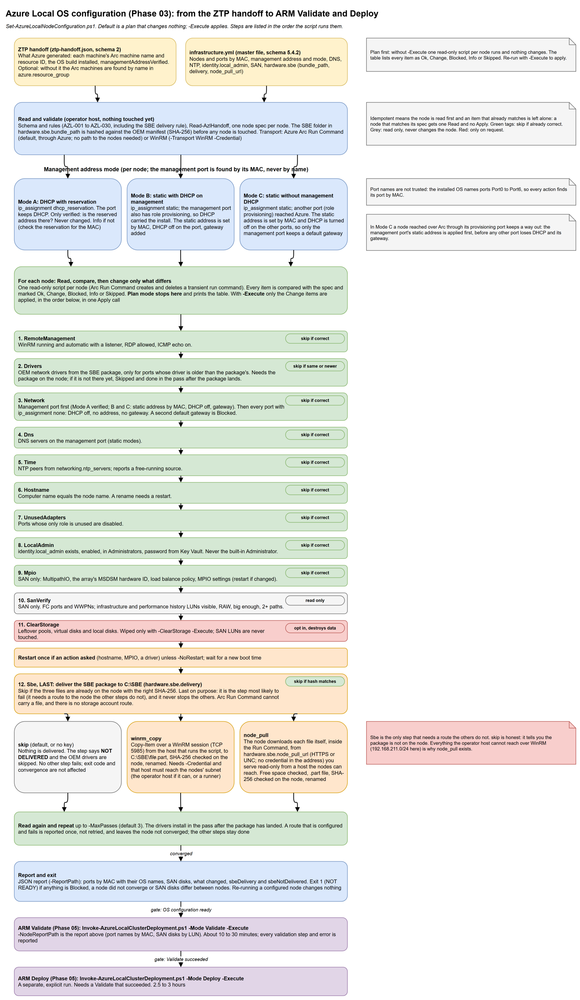

# OS configuration and ARM Validate/Deploy: prerequisites and run guide

Hardware discovery comes first in the flow: before azurelocal-ztp, it reads each node's iDRAC (service tag, the MAC of every port, which port is the management port, the BOSS card) and fills `serial_number` and `network_adapters[].mac_address` in `infrastructure.yml`. ZTP and the OS configuration read those values; the OS configuration finds every port by MAC. See `scripts/common/idrac-management/README.md`.

This page covers the two steps that run after azurelocal-ztp (or an ISO install) has handed off provisioned machines:

1. **OS configuration** (Phase 03): `scripts/deploy/04-cluster-deployment/phase-03-os-configuration/Invoke-AzureLocalOsConfiguration.ps1` runs it for the whole instance in one go (plan, apply, verify, one report); it calls `Set-AzureLocalNodeConfiguration.ps1` in the same folder once per node, which you can also run on its own
2. **ARM Validate, then Deploy** (Phase 05): `scripts/deploy/04-cluster-deployment/phase-05-cluster-deployment/Invoke-AzureLocalClusterDeployment.ps1`, with `New-AzureLocalArmParameters.ps1` for the parameter file alone.

Both read the one environment file, `infrastructure.yml` (schema 5). This page doesn't repeat what each key means: see the [schema-wide variables reference](../config/variables/docs/VARIABLES.md) and `config/variables/docs/infrastructure-file.md`. What it adds is what must be true before you run, and which of it the code checks.

In the tables, **Checked** says what happens if the item is missing:

- **Code**: the script checks it and stops (or blocks the node) with a message.
- **Azure**: the script doesn't check it, but the Azure call fails and the script reports Azure's error.
- **You**: nothing checks it. You make it true before the run.

## What runs where

| Step | Command (plan: reads, changes nothing) | Add `-Execute` to |
| --- | --- | --- |
| OS configuration | `Set-AzureLocalNodeConfiguration.ps1 -InfrastructureFile ./infrastructure.yml -HandoffFile ./ztp-handoff.json` | change the nodes. Re-running on a configured node changes nothing. |
| OS configuration, the whole instance in one run | `Invoke-AzureLocalOsConfiguration.ps1 -InfrastructureFile ./infrastructure.yml -HandoffPath ./ztp-state -Mode Plan` | use `-Mode Apply`. See [Run it in one go](#run-it-in-one-go). Also runs unchanged in GitHub Actions and GitLab CI. |
| ARM parameters only | `New-AzureLocalArmParameters.ps1 -InfrastructureFile ./infrastructure.yml -HandoffFile ./ztp-handoff.json -NodeReportPath <report>` | (reads files only; always safe) |
| ARM Validate | `Invoke-AzureLocalClusterDeployment.ps1 -InfrastructureFile ./infrastructure.yml -HandoffFile ./ztp-handoff.json -NodeReportPath <report>` | submit `deploymentMode Validate` to the resource group, wait, report the validation steps. |
| ARM Deploy | the same with `-Mode Deploy` | submit the real deployment. A separate, explicit run; needs a successful Validate. |
| **ARM Validate and Deploy, automated** | `Invoke-AzureLocalArmDeployment.ps1 -InfrastructureFile ./infrastructure.yml -OsConfigurationReport <report directory> -Mode Plan` | `-Mode Validate`, then `-Mode Deploy` (or `ValidateAndDeploy`): preconditions, idempotent re-runs, resume, approval gate, event feed, exit codes 0, 1, 2. Jump server or pipeline. See [arm-deployment-guide.md](arm-deployment-guide.md). |

The OS configuration plan reads each node through PowerShell remoting (WinRM) from a host that reaches the node's management address; nothing on the node changes. Azure Arc Run Command is the option you ask for with `-Transport ArcRunCommand` (see [Choosing the transport](#choosing-the-transport)). `-SpecOnly` reads no node and no Azure resource: it prints what each node should look like. The ARM plan (no `-Execute`) reads files only, unless you add `-Preflight`.

Order: ZTP hand-off (or an ISO install), OS configuration (`Invoke-AzureLocalOsConfiguration.ps1 -Mode Plan`, review the plan and the wipe list, then `-Mode Apply`; it writes a JSON report), then ARM Validate, review, then ARM Deploy.



The diagram source is [`diagrams/os-configuration-flow.drawio`](diagrams/os-configuration-flow.drawio). It follows one run: the ZTP handoff (schema 2) and `infrastructure.yml` are read and validated; each node's management address mode (A DHCP with reservation, B static with DHCP on management, C static without management DHCP) decides what the Network step does; then the steps run in the order the script runs them, with a tag on each that says whether it skips when already correct, only reads, or only runs on request; the SBE package is delivered last by the route `hardware.sbe.delivery` names; the node is read again until it matches, and the report feeds ARM Validate and then ARM Deploy (Phase 05). The diagram draws the node script, `Set-AzureLocalNodeConfiguration.ps1`; the one-run command described next wraps it.

**The whole flow, in one place.**

1. `Invoke-AzureLocalOsConfiguration.ps1` reads `infrastructure.yml` and every ZTP handoff, and works out each node's **method** (ZTP or ISO) from the file and from what answers: see [Which method?](#which-method).
2. **Plan** for all nodes, read only. The plan lists every item per node (the diagram's steps, in that order, the Sbe step last), and, when `os_configuration.clear_storage` is on, the disks that would be wiped ([Storage wipe](#storage-wipe-os_configurationclear_storage)). A person approves this output.
3. **Apply**, node by node. Each node's steps run in the order in the diagram. The SBE package is delivered last, by the route `hardware.sbe.delivery` names ([How the package reaches the nodes](#how-the-package-reaches-the-nodes)); a package that can't be delivered never stops the other steps.
4. **Verify** with a Plan pass; a node is converged only when nothing is left to change.
5. **Report** (`report.json`, `summary.md`) and exit code. `report.json` feeds ARM Validate, then ARM Deploy.
The full cross-tool matrix is in the toolkit's [access-and-connectivity page](access-and-connectivity.md).

## Run it in one go

`Invoke-AzureLocalOsConfiguration.ps1` (same folder as `Set-AzureLocalNodeConfiguration.ps1`) does the whole OS configuration phase for the whole instance in one run: every handoff file, every node, plan, apply, verification, one report. The same command runs on an operator's workstation and, unchanged, in a pipeline; there is nothing pipeline-specific in it. It calls `Set-AzureLocalNodeConfiguration.ps1` once per node and adds the parts around it.

```powershell
# Plan: reads every node, changes nothing, writes the plan report and the wipe list
./scripts/deploy/04-cluster-deployment/phase-03-os-configuration/Invoke-AzureLocalOsConfiguration.ps1 `
    -InfrastructureFile ./infrastructure.yml -HandoffPath ./ztp-state -Mode Plan -ReportDirectory ./osconfig-report

# Apply: the same command with -Mode Apply
./scripts/deploy/04-cluster-deployment/phase-03-os-configuration/Invoke-AzureLocalOsConfiguration.ps1 `
    -InfrastructureFile ./infrastructure.yml -HandoffPath ./ztp-state -Mode Apply -ReportDirectory ./osconfig-report
```

| Parameter | Meaning |
| --- | --- |
| `-InfrastructureFile` | The master `infrastructure.yml`. Required. |
| `-HandoffPath` | A handoff file, several files, or a directory. Every `*.ztp-handoff.json` found is merged into one node-to-handoff map. A node in two files is an error that names both files. Optional: a cluster installed from ISO has no handoff. |
| `-Node`, `-Step` | Limit the run to some nodes or steps. |
| `-Mode` | `Plan` (default) or `Apply`. |
| `-ReportDirectory` | Where `plan-report.json`, `report.json`, `summary.md`, `wipe-list.txt` and `node-reports/` go. |
| `-ContinueOnNodeFailure` | Default `$true`: a node that fails does not stop the others. `-ContinueOnNodeFailure:$false` stops at the first failure and marks the rest skipped. |
| `-Transport` | `Auto` (default) is PowerShell remoting (WinRM), or what `remoting.transport` says; `WinRM` and `ArcRunCommand` force it. Arc is never chosen automatically. |
| `-Method` | `Auto` (default) works the method out per node; force `Ztp` or `Iso` for all nodes. |
| `-Credential`, `-NodeAddress` | The local administrator for WinRM (default: `identity.local_admin`, password from the Key Vault, never printed) and the address to reach a node on when the installer's address is not in the file. On a node reached over Arc (only `-Transport ArcRunCommand`) the credential is used to copy the SBE package when `hardware.sbe.delivery` is `winrm_copy`. |
| `-ClearStorage` | Forces the storage wipe on (see below). |
| `-ConfigPath`, `-Settings` | Optional run settings (JSON file, then a hashtable that wins): `retryTries`, `retryDelaySeconds`, `maxPasses`, `noRestart`, `failOnPendingChanges`, `nodeAddress`, `networkRollbackMinutes`, `networkStableSeconds`, `reconnectWaitMinutes`, `staleRunCommandMinutes`, `addressProbe`, `remoting`, `addressResolution`. The guarded-change keys are in [Changing the management address safely](#changing-the-management-address-safely); `remoting` is in [Choosing the transport](#choosing-the-transport). |
| `-EventLogPath` | The event feed (JSON Lines), default `os-configuration-events.jsonl` in the report directory. |
| `-FailOnPendingChanges` | Plan mode: exit 1 when any change is pending (drift detection). |

### What the run does, in order

1. **Validate the inputs.** The master file, the handoff map, the method of every node, the **remoting pre-check** (every node probed at the same time on every candidate address, one table of what is unreachable and why), the credentials and the OS build of every node reached over WinRM. A failure here stops the run with exit code 2 before anything is changed.
2. **Plan for all nodes** (read only). Writes `plan-report.json` and `wipe-list.txt`.
3. **Apply** (`-Mode Apply`), node by node.
   Each node's steps run in the order of the diagram, `RemoteManagement` first and the SBE package last (by `hardware.sbe.delivery`). With an Active Directory design the order is Network, Dns, Time, Hostname, UnusedAdapters, **DomainJoin** (see [Joining the domain](#joining-the-domain)), LocalAdmin, MPIO, then the rest. A change that can cut the node off is a guarded change. A node whose plan says the package is NOT DELIVERED (`hardware.sbe.delivery` is `skip`) is not failed; its record carries a warning.
4. **Verify**: a Plan pass on every node that was changed. A node is *converged* only when this pass finds nothing left to change. The status of the commands that did the work does not decide it. A node with nothing to change in the plan is converged by the plan itself and is not read again.
5. **Report**: `report.json` (per node: method and evidence, steps, plan, changes, errors, converged, restarted), `summary.md` and a table on the console.

### Which method?

OS configuration always starts after the OS is installed, however it was installed. Each node is resolved on its own, so a cluster can mix both.

- **Declared**: `scenario.os_install` (`iso` or `simplified`) in the master file.
- **Evidence**: (a) a ZTP handoff for the node that says `ready`, (b) an Arc machine for the node that is `Connected` (found by the handoff's resource ID, else by host name in `azure.resource_group`), (c) the node answers on WinRM (TCP 5985, or 5986 with HTTPS) at `nodes[].management.ip_address`, `maintenance_address` or the address the Arc agent reports (`-NodeAddress` overrides).

| Declared | Evidence | Path | |
| --- | --- | --- | --- |
| simplified | ready handoff, or a Connected Arc machine | ZTP | |
| iso | ready handoff | ZTP | warning naming both; fix `scenario.os_install` |
| iso | Connected Arc machine, no handoff | ISO, reached over Arc | already registered |
| iso | answers on WinRM | ISO, reached over WinRM | |
| simplified | no ready handoff, no Arc machine, answers on WinRM | ISO | warning naming both |
| any | nothing reachable | none | exit 2 with what was tried |
| any | a handoff for another subscription or resource group than the master file | none | exit 2: contradictory evidence |

The result is in the report, per node (`method.declared`, `method.resolved`, `method.source`, `evidence`), and printed at the start. `-Method Ztp|Iso` forces it.

| | ZTP path | ISO path |
| --- | --- | --- |
| Reached with | PowerShell remoting (WinRM) with the local administrator from the master file, from a host that reaches the node's management address | the same |
| Verified, not redone | OS build, Arc machine connected, the computer name ZTP gave, the handoff's `ready` | |
| Done | management static address by MAC, DHCP off on the other ports, DNS, NTP, unused ports, local admin, RDP/ICMP, OEM drivers, MPIO and SAN verification, storage wipe when on, and last the SBE package (by `hardware.sbe.delivery`) | all of those, plus the computer name (restart), and Azure Arc registration |
| Up front | route to TCP 5985/5986, credentials, OS caption and build 25398 or later | the same; each failure names the node and says what to fix |

Arc registration on the ISO path runs `Invoke-AzStackHciArcInitialization` on the node with the ARM token of the run's own Azure sign-in (passed as a secret; never written), into `azure.resource_group`, with the Arc gateway from `networking.outbound.arc_gateway` when the outbound path uses one. It then waits for the Arc machine to be Connected. The older Phase 04 registration scripts take a different, interactive configuration, so they are not used here. WinRM from a Linux runner needs the PSWSMan module for Negotiate authentication. Arc registration is done over WinRM too.


### How the node's current address is found

You do not need to know the address a node holds now. The temporary DHCP address of a node installed from the ISO is not in the master file (the file holds the address it is to get), and a ZTP node may still hold its DHCP address too. For each node reached over WinRM the run looks in this order, first match wins, and names the source in the plan line, in the `TransportResolved` event (`addressSource`, `addressTried`) and in `report.json` (`addressSource`, `evidence.address`):

1. **override**: `-NodeAddress` or the `nodeAddress` run setting. Final: if it does not answer, no other address is tried, so credentials never go to an address you did not give.
2. **ztp-handoff**: the node's adapters in its `*.ztp-handoff.json` (`networkAdapters[]`, each with `ipAddress` and `macAddress`), matched by the management MAC from `infrastructure.yml`. ZTP nodes only; a manual install has no handoff, and that is normal.
3. **arc**: the network profile the Arc agent reports for the node's Arc machine (same MAC), when the node is registered and you are signed in to Azure.
4. **infrastructure-file**: `nodes[].management.ip_address` (and `maintenance_address`). A manual install done with the planned static IP is found here.
5. **mac-lookup**: from the orchestrator, only when 2 to 4 gave no answer. It reads the neighbor table (`Get-NetNeighbor`, else `arp -a`) for the management MAC on `networking.management.subnet`. If the table has no entry yet, a ping sweep of that subnet fills it (ARP is answered even when the node blocks ping). It works only on a machine that is on that subnet, because only then does it share the layer-2 segment with the node; on any other machine the message says so and the step is skipped. A subnet wider than /22 is refused unless `addressResolution.allowWideSubnet` is true in the run settings. Nothing outside that subnet is ever pinged. On Linux and macOS without `Get-NetNeighbor` the run uses `arp -a`, and skips the step when neither exists.
6. **none**: exit code 2. The message asks for the address and lists what each source gave, for example `Cannot find the current management address of iic-n02 (management MAC 00:00:5E:00:53:20). ... Give the address the node answers on now: -NodeAddress @{ 'iic-n02' = '<ip>' }`.

Every candidate is probed with a TCP connect on 5985, then 5986, and the one that answers is preferred over one that does not. If several answer, the first source in the order above is used and a warning names the others and says why. Resolution only connects to ports: no credential is sent, nothing is changed, IPv4 only. When a discovered address is not in the file and TrustedHosts is managed with exact entries (class `dev`), it is added for the run and restored with the rest.

Run settings (`-Settings` or the settings file), all optional: `addressResolution = @{ sweep = $true; allowWideSubnet = $false; pingTimeoutMilliseconds = 500 }`.

### Choosing the transport

The node-side logic is PowerShell and is the same everywhere. WinRM and Arc Run Command are only ways to deliver it. **PowerShell remoting (WinRM) is the default and the only transport that is ever chosen automatically.** Arc Run Command is an option you ask for; it is never a silent fallback.

| Where the run starts | Use | Notes |
| --- | --- | --- |
| A jump server on the management network, run by hand | WinRM (default) | Windows PowerShell 7 on the jump server. Kerberos or Negotiate. |
| A CI/CD runner (GitHub, GitLab, Azure DevOps) with a route to the management network | WinRM (default) | A Windows runner, or a Linux runner with PowerShell 7 and the PSWSMan module for Negotiate/Kerberos, or WinRM over HTTPS (`-UseSsl`, 5986, a certificate on the node). |
| A runner that only reaches Azure (no route to the nodes) | `-Transport ArcRunCommand` | The exception. Everything, including the guarded network change, goes through Azure Arc Run Command. Not recommended for network changes: the Arc agent loses its route while the address changes, so the run depends on the node's own rollback and on the Arc machine reconnecting. |
| A ZTP node whose firewall is still closed to your subnet | WinRM with `-Settings @{ remoting = @{ bootstrapTransport = 'arc' } }` | Arc is used once per node, only to open WinRM-In (and RDP, ICMP when in the plan) for the source CIDRs. Everything after that goes over WinRM. |

**Why a closed firewall happens.** A freshly provisioned node's Windows Firewall rules for remote management (WinRM-In, Remote Desktop, ICMP echo) allow the local subnet only. A jump server or runner on another subnet reaches TCP 445 but not 5985, 5986, 3389 or ICMP, until the RemoteManagement step opens them. That is a chicken-and-egg problem; the bootstrap resolves it once.

| Setting | Values | Default | Meaning |
| --- | --- | --- | --- |
| `remoting.transport` (master file `os_configuration.remoting.transport`) | `winrm`, `winrm_https`, `arc` | `winrm` | `-Transport Auto` follows this. `WinRM` and `ArcRunCommand` on the command line win. |
| `remoting.bootstrapTransport` (`os_configuration.remoting.bootstrap_transport`) | `none`, `arc` | `none` | `none`: a node that does not answer on 5985/5986 fails with the diagnosis. `arc`: one Arc Run Command per node to open the firewall. |
| `remoting.allowedSourceCidrs` (`os_configuration.remoting.allowed_source_cidrs`) | list of IPv4 CIDRs | the management network | The runner and jump server CIDRs. The management network (`networking.management.subnet`) is always included, and so is `LocalSubnet`. |
| `remoting.useSsl`, `-UseSsl` | true/false | false | WinRM over HTTPS (5986). |
| `remoting.authentication`, `-Authentication` | `Default`, `Negotiate`, `Kerberos`, `Basic`, `CredSSP` | `Negotiate` | A workgroup node needs `TrustedHosts` on the runner (HTTP) or HTTPS. A domain-joined node can use Kerberos. |

The credential is `-Credential`, or `identity.local_admin` with its password read from the Key Vault (never printed). **The pre-check.** Before anything changes, every node is probed on every candidate address (`nodes[].management.ip_address`, `maintenance_address`, the address the Arc agent reports for the management MAC) at the same time, and one table says which node is unreachable and why (port closed, timeout, no route, no credential). A node with no answer fails with exit code 2 and the next action, for example "the node firewall probably limits WinRM to its own subnet; run once with `-Settings @{ remoting = @{ bootstrapTransport = 'arc' } }` or open WinRM-In for your CIDR by another means". Arc is not tried.

The report records the transport per node and per step (`stepTransports`) and whether the bootstrap was used (`bootstrap`); the event feed has a `TransportResolved` event per node and one for the bootstrap.

### Changing the management address safely

Changing the management address, the gateway, DNS or VLAN, the remote-management firewall rules, the time source, turning DHCP off on the other ports, disabling unused adapters, or renaming the computer can cut off the very connection the change is made over. So none of these runs inline. Each is a **guarded change**: the session only stages it, and the node applies it, checks it and rolls it back by itself.

**What happens**

1. **Stage.** One short script puts the change on the node (a script in its own folder under `C:\ProgramData\AzureLocal\osconfig`, readable by SYSTEM and Administrators only, its SHA-256 in the state file as the manifest) and starts it detached. It returns at once with a node cookie and the machine SID. The session is closed.
2. **The node works alone.** A controller process takes a machine-wide mutex (`Global\AzureLocalOsConfig`), takes a snapshot of the ports (and writes a panic document first), then applies the change. The **new** address and route are added first; the old address stays until the change is confirmed. Windows duplicate address detection must report `Preferred` (a `Duplicate` means refuse and revert; the address is never applied again). A scheduled task (at startup and every minute, no time limit) is the backstop that starts the same script again after a crash or a reboot.
3. **Local checks.** The node checks, in this order, and they must stay green for `networkStableSeconds`: the management port has the expected address, prefix, VLAN and a default gateway; the gateway resolves to a MAC and a configured TCP probe answers through that port; a name resolves; WinRM is listening (if it was); the cleaned ports have no address or route. Only checks that passed before the change are required afterwards. The Arc agent is evidence, not a condition; ICMP is not either.
4. **Repair.** If a check fails: one more look, then the Arc agent services (if Arc was in use), then the snapshot of the failing item only, then the adapter that was disabled, then the whole snapshot. Nothing is re-applied and no NIC is restarted as a repair: after a failed probe the next step is a restore.
5. **Confirmation.** This host closes its session, waits, and reaches the node again on the **new** address (then the old one), through a **new** session. In `AwaitingConfirm` it writes a token (SHA-256 of change id, script hash and node cookie). Only then does the node commit and remove the old address. With no confirmation inside `networkRollbackMinutes` the node restores the snapshot on its own. Over Arc this host polls the Arc machine until it is Connected with a newer last status change, then reads the state through a second short run command.
6. **Order.** The management address first (confirmed `Committed`), the VLAN as its own change, then the other steps, then the services group, then the computer name (its own change, with a restart that the watchdog finishes), and DHCP off on the other ports and disabled adapters last, only while the management port has a default gateway (and, over Arc, the Arc machine is Connected); otherwise they are Blocked with the reason. Nothing continues on a node until the previous change is `Committed`. If the address is already right, nothing is staged.

**States** (the node's state file `net-<id>.state.json`, read by a short second command)

| State | Meaning |
| --- | --- |
| Staged | Script, manifest hash and desired state are on the node. |
| Snapshotted | The pre-change state and the panic document are saved. |
| Applying | The changes are being made. |
| Verifying | The local checks must stay green for `networkStableSeconds`. |
| Repairing | A check failed; the repair ladder runs. |
| AwaitingConfirm | Local checks passed; waiting for this host's confirmation token. |
| Committed | Both proofs; the old address is gone; the watchdog is removed. |
| RolledBack | The snapshot (or the failing item) was restored. `verdict`: `RolledBackVerified`. A confirmation that arrived too late is recorded as `RolledBackLateConfirm`. |
| Refused | Nothing was changed: another host answers on the address, the plan would disable the management port or the port holding the default gateway, the management port is an LBFO team member or a vSwitch uplink, the VLAN driver capability is unknown, or the script hash differs. |
| Failed | The restore could not be verified (`RollbackUnverified`). The watchdog stays armed and keeps trying; the node needs console or BMC access. |

A read that cannot reach the node is **PendingReconciliation**, never a failed change: the node's own deadline decides, and a re-run reads the change first (a Committed change id is a no-op).

**What to do**

| Result | Do |
| --- | --- |
| RolledBack | The node is as it was. Read `<id>.log` on the node (the report has the reasons and the rungs used). Fix the cause (address in use, wrong gateway, VLAN, a firewall between this host and the new address) and run again. A rolled back change is not retried automatically. |
| Refused | Nothing changed. Fix what the reason names. |
| Failed | Go to the console. The panic document `net-<id>.panic.json` and the log say what was tried. |
| PendingReconciliation | Check the route to the node and run again. |

**Management address modes.** A (`dhcp_reservation`): never changed, only verified. B (static with DHCP at provisioning) and C (static, no management DHCP): the guarded change; a node that already holds the wanted address through DHCP is converted in place. `dhcp` without a reservation and `preconfigured`: left alone.

**Settings** (`-Settings`, or the JSON `-ConfigPath`)

| Key | Default | Meaning |
| --- | --- | --- |
| `networkRollbackMinutes` (master file `os_configuration.network.confirm_minutes`) | 10 | The window for this host's confirmation. Without it the node reverts. |
| `networkStableSeconds` (`os_configuration.network.stable_seconds`) | 60 | How long the local checks must stay green. |
| `reconnectWaitMinutes` | 15 | How long this host waits for the node to answer again. |
| `staleRunCommandMinutes` | 15 | Before an Apply over Arc (a plan deletes nothing), run commands named `azl-osconfig-*` older than this and not Succeeded or Running are deleted (recorded as a `StaleRunCommandDeleted` event in the node report; not written to the feed, whose states are the contract's). Nothing else is touched. |
| `addressProbe` | true | Refuse an address another host answers on (ping, neighbour cache) before assigning it. |

**Events.** The feed (Sonar shows them) has `NetworkChangeStaged`, `NetworkChangeVerifying`, `NetworkChangeAwaitingConfirm`, `NetworkChangeCommitted`, `NetworkChangeRepaired` (with the rung), `NetworkChangeRolledBack`, `NetworkChangeRefused`, `NodeReconnecting`, `NodeReconnected`, `NodeBlocked`, each with the old and new address in the evidence.

**The guarantee, and its limits.** The design bounds the time a node stays cut off: if this host cannot confirm within the window, the node reverts itself, and a crash or reboot of the node does not stop that. It does not promise that no node is ever lost. It assumes: the node's Task Scheduler and PowerShell 5.1 work; the snapshot is routable (a node that only had a DHCP lease and no DHCP server on the network cannot be restored to it, so the restore is a static copy of the old addresses); the disk is writable; the change is not a hardware or driver failure. **Hazardous network changes need an independent recovery path** (BMC, iDRAC, iLO or a console) available when you run them.

**What is verified and what is not.** Verified by tests with fakes, on any host with no node: the engine's states, checks, repair rungs, refusals, panic restore, fencing and watchdog resume; the orchestrator's staging, waiting, confirming, reconnect polling and outcome reading; the pre-check, the bootstrap order and the transport rules. **Not verified, because it needs a real Windows Server node:** the real Windows cmdlets (address, route, VLAN, firewall, adapter, scheduled task, mutex), duplicate address detection timing, `azcmagent show` output, the scheduled task surviving the end of a WinRM session or an Arc run command, the accepted local endpoint of the confirmation session, and LBFO/vSwitch detection. **Run the first live apply on one node**, with BMC access, before the rest.

**Deferred.** Write-ahead journal with a sequence number (the state is atomic, checksummed, copied and fenced by a generation number); union of the old and new WinRM firewall scope during the window (the bootstrap and the RemoteManagement step set the scope); checking the local endpoint the confirmation session arrived on; per-operation time limits for every native command.

### Storage wipe: `os_configuration.clear_storage`

Leftover local storage (storage pools, virtual disks, the data on local disks) is wiped only when the master file says so:

```yaml
os_configuration:
  clear_storage: true   # default false
```

`-ClearStorage` forces it on. The wipe happens only in Apply mode, and only to what the plan listed. Boot, system, SAN (Fibre Channel, iSCSI) and USB disks are never touched. With `clear_storage` on, the run prints, before anything is applied, exactly which disks on which node will be wiped, taken from the plan, and writes the same list to `wipe-list.txt` and the end of `summary.md`:

```text
STORAGE WIPE (os_configuration.clear_storage in the master file). Local disks that WOULD BE WIPED if you apply. ...
  tplabs-azl-n01: 1 pool(s), 2 virtual disk(s), disks: 3 (1000 GB) ...
```

With it off, leftover storage is reported as blocking (exit 1) and nothing is wiped.

### Joining the domain

With `scenario.identity: active_directory` the OS configuration joins every node to the domain, into the OU from the file, **before** the ARM validation and the deployment (the `DomainJoin` step). With `local_identity` the step reports one item, `not applicable: local identity`, and does nothing.

**What it does.** For each node, in the order of the run: Network, Dns, Time and Hostname first (the join needs the domain controllers reachable by name, clocks within 5 minutes and the final computer name), then `DomainJoin`, then LocalAdmin, MPIO and the rest. Both methods run it (ZTP nodes are named by ZTP; ISO nodes get their name from the Hostname step first). On an ISO node it runs **before** the Arc registration: registration does not need the join, and the join restarts the node, so the registration waits for it. The step:

1. **Reads** (plan, nothing changed): `PartOfDomain` and `Domain`, the computer's distinguished name when joined (so its OU), DNS resolution of the domain and the domain controller SRV record, a TCP check of the controllers, the clock difference to a controller, `Test-ComputerSecureChannel` when joined, the computer name against the file, whether the node is already in a cluster, the local Administrators group, and (with the join credential, over LDAP from the node) the OU itself: that it exists, whether Group Policy inheritance is blocked (`gPOptions`), and which GPO links above it are Enforced. The credential is sent to a node **only with `-Execute`**: a plan reports "OU not verified" and sends nothing. The first time a domain controller rejects the credential (wrong password, locked, disabled, expired) a run-wide latch is set: that node's OU and join are Blocked, and no later node or pass gets an OU check or a join with it, so a wrong password is sent once, not once per node.
2. **Compares**: joined to the right domain and OU = Ok; not joined = Change; a different domain, a different computer name, DNS that cannot resolve the domain, no domain controller, a clock more than 5 minutes apart, an OU that does not exist or does not block inheritance (in `dev`, `production` and `dmz`) = **Blocked**, with every reason in the note. An earlier step that still has a change makes the join wait (Skipped); the next pass of the same run does it.
3. **Joins**: `Add-Computer -DomainName <domain_fqdn> -OUPath <ou_path> -Credential <account> -Restart:$false` on the node, in Windows PowerShell 5.1. The credential is built on the node from a secure string made from the secret, which the run read from Key Vault. Then the **guarded restart**: a durable marker (`C:\ProgramData\AzureLocal\osconfig\domainjoin-state.json`, written to a temporary file, flushed to disk, renamed) says a restart is expected; a one-time startup task resumes and verifies after the restart even if the run has died; the node refuses to restart without the marker; the run reconnects over the same transport (the WinRM address from the file, or Arc) and verifies **PartOfDomain true, the right domain, `Test-ComputerSecureChannel`, the right OU**, then completes the marker. If Group Policy has not stored the computer's distinguished name yet, the node refreshes the computer policy and it is read again; an OU that stays unknown is *unverified*, never OK (an account that already existed is reused where it is, and nothing moves it after the deployment). The state folder is restricted to SYSTEM and Administrators.
4. **Adds the local administrators**: the principals of `identity.active_directory.local_admin_members` (default: the `security_groups` entry whose `purpose` says it administers the instance, and the LCM user) are added to the node's local Administrators group, idempotently, after the join and the restart. A domain account is not a local administrator by default; the deployment adds the LCM user itself later. This is what lets Kerberos remoting and Sonar's log access use a domain account.

**The account.** The default is the **LCM user** (`identity.active_directory.lcm_user`, password by `keyvault://` reference). Microsoft's Active Directory preparation gives it the right to create and delete computer objects in the dedicated OU, and it is the account used for domain-join actions such as repairing or adding a node. To use another account set `identity.active_directory.domain_join_account` (username and password reference); it needs the same rights on `ou_path`. What the account needs on the OU (Microsoft, [Custom Active Directory configuration](https://learn.microsoft.com/azure/azure-local/plan/configure-custom-settings-active-directory)):

| On the OU and its descendants | Permission |
| --- | --- |
| Computer objects | List contents, read all properties, read permissions, **create** computer objects, **delete** computer objects |
| `msFVE-RecoveryInformation` objects below it | Full control (the BitLocker recovery keys; set with PowerShell, the delegation wizard cannot) |
| Resetting the password and writing `dNSHostName` and `servicePrincipalName` | Needed when a computer object already exists in the OU (pre-staged, or from an earlier join) |

`New-HciAdObjectsPreCreation` sets this up for the LCM user. The LCM user also needs *Log on as a batch job* and interactive logon (the default domain policy must not deny them); that is checked by the deployment, not here.

**The OU.** Azure Local requires a dedicated OU with Group Policy inheritance **blocked**; `New-HciAdObjectsPreCreation` creates it. The plan reads it:

| Finding | `dev`, `production`, `dmz` | `lab`, `test` |
| --- | --- | --- |
| OU does not exist | Blocked | Blocked |
| Inheritance not blocked | **Blocked** (nothing is joined) | warning, the join goes ahead |
| GPO links marked **Enforced** above the OU | warning | warning |

The class is `scenario.environment_class`; missing means `production`. Block Inheritance does not stop **Enforced** GPOs, so the plan names them and suggests what Microsoft suggests: a WMI filter on those GPOs that excludes the Azure Local machine accounts. (Microsoft's own at-scale advice links an Enforced GPO on the parent OU on purpose, for example to nest a domain group in the local administrators; then the warning is expected.) The characters `& " ' < >` are not allowed anywhere in `ou_path` (rule AZL-051).

**If the join fails.** The node stays in its workgroup and the report carries the exact error text from `Add-Computer`, its code and what to do. The join is **not retried in the same run** (a wrong password must not be sent twice; it would lock the account). The usual errors:

| Code | Meaning | What to do |
| --- | --- | --- |
| 1326 | the user name or password is wrong | check the account and the Key Vault secret; do not run again with the same values |
| 1355 | the domain does not exist or no controller answers | the management DNS servers must be the domain controllers (`domain_controllers`, rule AZL-052); check the route |
| 2224 | a computer object with that name already exists | delete it, or move it into `ou_path`; a pre-staged object **in** `ou_path` is fine if the account may reset its password |
| 5 | access denied | delegate the rights above on `ou_path` |
| 53, 1722 | network path not found, RPC server unavailable | routing and firewalls to the controllers (TCP 135, 389, 445 and the dynamic RPC range) |
| clock skew | more than 5 minutes from the controller | fix the Time step first |
| 1909, 1331 | account locked out or disabled | unlock or enable it |
| other | not mapped | the exact text is reported; look the code up in Microsoft Learn |

**Events** (the run's event feed, `os-configuration-events.jsonl`, step `DomainJoin`): `DomainJoinPlanned`, `DomainJoinApplying`, `NodeRestarting`, `NodeReconnected`, `DomainJoined`, `DomainAdminsConfigured`, `DomainJoinFailed` (with the AD error and the next action). `DomainJoined` is when Sonar switches the credential it uses for the node to the domain account. The password is in none of them, nor in the report.

**A node in the wrong OU, and how to move one.** A node already in the domain but in another OU than `ou_path` is **Blocked**, never moved by default. Microsoft states that moving the computer objects to a different OU **after the deployment is not supported**, so a node that is already part of a cluster is blocked whatever the file says: correct `ou_path` to where the objects are, or follow Microsoft's repair or add-node procedure. **Before the deployment** you can set `identity.active_directory.join_options.allow_ou_move: true`; the next Apply moves the computer object into `ou_path` (ADSI, with the join account) and the plan then shows Ok. A node joined to a **different domain** is Blocked and is never unjoined by the toolkit: run `Remove-Computer` on it yourself if that is what you want. A rename after the join is refused (`join_options.rename_after_join` is fixed to `false`).

**What was not tested.** The scripts and the comparison are tested with mocks only. Nothing here was run against a domain controller; run the first node as a canary.

**Note for the azurelocal.cloud automation guide.** Where the guide describes the one-run OS configuration, add: *"With an Active Directory design the OS configuration also joins each node to the domain and the dedicated OU (step DomainJoin, after Network, DNS, Time and Hostname, before the ARM validation), using the LCM user from `infrastructure.yml` unless `domain_join_account` is set. The plan checks that the OU exists and blocks Group Policy inheritance, and warns about Enforced GPOs; a node in another OU is blocked (Microsoft does not support moving computer objects after deployment). The nodes' local Administrators group gets `local_admin_members`. Events: DomainJoinPlanned, DomainJoinApplying, DomainJoined, DomainJoinFailed, DomainAdminsConfigured, NodeRestarting, NodeReconnected."* The Implementation guide keeps the manual route (Prepare Active Directory, then the join in the deployment).

### Exit codes

| Code | Meaning |
| --- | --- |
| 0 | Apply: every node converged. Plan: every node could be read and nothing is blocked (pending changes are expected; `-FailOnPendingChanges` makes them exit 1). |
| 1 | A node failed, is blocked, or did not converge; or the nodes do not see the same SAN disks. |
| 2 | Bad input or nothing reachable: a missing file, a node in two handoffs, contradictory evidence, no sign-in for Arc, a precondition of the ISO path. Nothing was changed. |

### A run command that ends in state Unknown

Only with `-Transport ArcRunCommand`. Arc Run Command can end in state `Unknown` when the node's agent briefly loses its connection (for example while its network changes). The script on the node is safe to run again, so the run is retried with a growing pause (default 3 tries, 15 s, 45 s, then 120 s; `retryTries`, `retryDelaySeconds`). After the last try the node is **read again** and the next step is decided from what the read shows. If an Apply ended in `Unknown`, the report lists a change with status `unknown`, and the node is converged if the read (and the verification pass) shows it matches. A restart that ends in `Unknown` is not a failure: the run waits for a new boot time.

### How long a call may take, and what an unreadable guarded change does

Every call to a node has a timeout, and the hard cap over WinRM is that timeout plus 15 seconds; past the cap the call is abandoned (its session is dropped and cleaned up in a background thread job, so the host never waits on it). Sessions are opened with an open timeout of 30 s and a cancel timeout of 5 s. If the node script had already written its result line when the call was abandoned, that answer is used (it is marked as recovered from the timeout).

| Call | Timeout | Hard cap |
| --- | --- | --- |
| Guard status, guard acknowledgement | 30 s | 45 s |
| Guard stage | 60 s | 75 s |
| Read | 90 s | 105 s |
| Restart script | 60 s | 75 s |
| Apply (inline), no storage wipe | 300 s | 315 s |
| Apply (inline), with a storage wipe | 900 s | 915 s |
| SBE `node_pull` (the node downloads) | 3600 s | 3615 s |
| SBE `winrm_copy`, per 8 MiB chunk | 60 s | 75 s |

Each attempt of a call is one `NodeCallAttempt` event (payload, duration, address, state, error), so the feed shows what a slow run was waiting for, and the heartbeat names the call (`Guarded change Services`, `Read (pass 2)`).

**A guarded change whose status cannot be read** no longer stops the run when the node shows the change done. After the node's own confirmation window has ended, the run reads the node once (90 s) and compares it with the plan. If none of the group's items is still to do, the outcome is **`ObservedCommitted`** (an event and a warning in the report, not an error) and the run goes on with the next step; the Read at the end of the run still decides whether the node is converged. If an item is still to do, the outcome stays `Unknown`, the run stops as before and the change is reconciled by the next run (`-ReconcileChangeId`). After one status call has timed out, the reads that come last (the final guard read, the read after an error, and the pending-change read) use a 30 s cap.

### The event feed: what the run tells a viewer

While it runs, the OS configuration appends what it does to a file, one JSON object per line (JSON Lines, UTF-8 without a byte-order mark, UTC timestamps). A viewer such as azurelocal-sonar follows the file; you can read it with any text tool. The default is `os-configuration-events.jsonl` in `-ReportDirectory`; `-EventLogPath` puts it somewhere else. Lines are only appended, so a path shared by several runs keeps the history of all of them. Writing the feed never fails the run: if the file cannot be written, the run goes on without it.

Every line has the shape azurelocal-ztp's event file has, so one reader follows both:

| Field | Meaning |
| --- | --- |
| `timestamp` | UTC, ISO-8601 round-trip (`2026-11-07T19:01:59.5360000Z`) |
| `node` | the node's name, or `*` for an event about the whole run |
| `stage` | always `OsConfiguration` |
| `step` | the step the event is about, empty for node and run events |
| `state` | what happened (the tables below) |
| `evidence` | one line of plain text: what was found, changed or failed |
| `level` | `Info`, `Warning` or `Error` |
| `nextAction` | what to do next, empty when nothing |
| `method` | `Ztp` or `Iso`; empty for a run event and before the method is known |
| `transport` | `ArcRunCommand` or `WinRM` |
| `payloadVersion` | the version of the node payload (the format the nodes answer in) |
| `schemaVersion` | the master file's `_metadata.schema_version` |

Run events (node `*`):

| State | When | Extra fields |
| --- | --- | --- |
| `RunStarted` | the inputs are valid and the run begins. `evidence` names the nodes | `nodes` (array of names; a viewer clears exactly these nodes), `mode`, `cluster`, `schemaVersion` (the master file's `_metadata.schema_version`), `wrapperVersion` |
| `PlanCompleted` | every node was planned (read only) | `changes`, `blocked`, `mode` |
| `WipeListPublished` | the wipe list was written (`Warning` when disks will be wiped) | `wipeCount`, `clearStorage`, `wipe` (array of `{ node, disks }`) |
| `WipeListApproved`, `WipeListRejected` | Apply was bound to the approved wipe list (`-ApprovedWipeList`): it matched, or a disk was not on it and the run stopped with exit code 2 before anything changed | `wipeCount`, `hash`, `approvedHash` |
| `RunCompleted` | last event; also written when the run stops on bad input or an error | `exitCode`, `converged`, `total`, `mode` |

Node events:

| State | When | Extra fields |
| --- | --- | --- |
| `NodeStarted` | the run starts on the node. A viewer starts a new attempt for the node here | |
| `MethodResolved` | the method is decided (`evidence` names the declared `scenario.os_install`, the evidence found and any warning; `Warning` when the declaration and the evidence disagree). Written once more after the first read of the node, to add the OS it reported | `declared`, `declaredMethod` (`Ztp` or `Iso`), `source`, `mismatch`, `steps`, `handoff`, `arc`, `winrm`, `warnings`, `hostname`, `osVersion`, `build`, `osCaption` (ISO path), `schemaVersion`, `wrapperVersion`, `sbePublisher`, `sbeFamily`, `sbeVersion`, `sbePackage`, `sbeDelivery` |
| `TransportResolved` | how the node is reached (`transport` on the line); `address` and `forced`; for WinRM the source of the address (see [How the node's current address is found](#how-the-nodes-current-address-is-found)) | `address`, `forced`, `addressSource`, `addressTried` |
| `NodeRetry` | an Arc Run Command ended in state `Unknown` and is tried again | `try`, `tries`, `waitSeconds`, `phase` |
| `NodeRestarting` | the node was asked to restart (written when the apply call reports it) | |
| `NodeReconnecting`, `NodeReconnected` | the node restarted or its address changed and the run waited for it, then reached it again. For a restart inside an apply call they are written when the call reports it, before the `StepApplied` events of that call | |
| `NodeConverged` | the plan found nothing to change, or the verification pass found nothing left to change | |
| `NodeFailed` | the node could not be read, a step failed, or it did not converge (`Error`) | |
| `NodeBlocked` | an item is blocked (`Warning` in Plan mode, `Error` after an apply), or the node was skipped because an earlier node failed | |

Step events (`step` is one of `RemoteManagement`, `Network`, `Dns`, `Time`, `Hostname`, `UnusedAdapters`, `LocalAdmin`, `Mpio`, `SanVerify`, `ClearStorage`, `Sbe`, `Drivers`, `ArcRegistration`):

| State | When | Extra fields |
| --- | --- | --- |
| `StepPlanned` | after the plan pass. `evidence` starts with the action and shows the items that decide it as `item: current -> desired` | `action` (`Ok`, `Change`, `Blocked` or `Info`), `item`, `current`, `desired`, `verifyOnly` (ZTP nodes: Hostname and ArcRegistration are checked, not changed) |
| `StepApplying` | the apply call is about to change the step | `item`, `current`, `desired` |
| `StepApplied` | the apply call reports the step's changes as done | |
| `StepFailed` | the apply reports a failed change, or the verification pass still finds the step different | `action`, `item`, `current`, `desired` |
| `StepSkipped` | the step does not apply to this node or run; `evidence` starts with `Not applicable:` and says why (not selected with `-Step`, no SBE bundle, the storage wipe is off, ...) | |
| `StepVerified` | the verification pass finds the step matching | `action` |

Domain join (step `DomainJoin`, Active Directory designs): `DomainJoinPlanned`, `DomainJoinApplying`, `DomainJoined`, `DomainAdminsConfigured` (the LCM user, or the listed principals, were added to the node's local Administrators) and `DomainJoinFailed` (`evidence` is the AD error). A viewer such as azurelocal-sonar switches the account it reads a node's logs with from the local account to the domain account only after both `DomainJoined` and `DomainAdminsConfigured`: before the second, a domain account is not an administrator of the node.

Guarded network change (step `Network`): `NetworkChangeStaged`, `NetworkChangeVerifying`, `NetworkChangeAwaitingConfirm` (`confirmMinutes`, `confirmBy`), `NetworkChangeCommitted`, `NetworkChangeRepaired` (`rung`), `NetworkChangeRolledBack` (`reason`: the node's own reason) and `NetworkChangeRefused`. They carry the optional fields `changeId`, `rung`, `reason`, `confirmMinutes` and `confirmBy` (the UTC time the confirmation window ends). The contract is section 6 of the OS configuration design in the platform repository (`pmo/azure-local/os-configuration-design.md`).

Every line carries `runId` (the id of the run; a feed path that is reused keeps the lines of every run, and the id tells them apart) and `seq` (1, 2, 3 ... per run id in the file). Free text is redacted before it is written (passwords, tokens, bearer headers, SAS signatures, keys, node result lines become `***`). The one registry of states is `Get-AzlOsConfigurationEventState`; besides the tables above it holds `StaleRunCommandDeleted` (step `Transport`). Apply with a non-empty wipe list needs `-ApprovedWipeList` (the `wipe-list.json` of the Plan run, with node and disk serials and a SHA-256), and a node that belongs to a deployed cluster is wiped only with the one-shot `-ConfirmWipeDeployedCluster`.

Order for one node in Apply mode: `NodeStarted`, `MethodResolved`, `StepPlanned`/`StepSkipped` for every step, `StepApplying`, `StepApplied` (or `StepFailed`), `StepVerified`, then `NodeConverged`, `NodeFailed` or `NodeBlocked`. A node whose plan shows nothing to change goes straight to `NodeConverged`. Run `Get-Content os-configuration-events.jsonl -Wait` to watch a run.

What differs by method: on the ZTP path `Hostname` and `ArcRegistration` are planned as `verifyOnly` steps (the computer name the node reports, the handoff's `ready`, the Arc machine's state); on the ISO path they are real steps (a restart for the name, the Arc registration). `method` and `transport` are on every node line, so a cluster that mixes both is read line by line.

### How the plan and the approval gate work

The plan changes nothing, so it can run unattended. Its output is what a person approves: the plan table per node, the method and transport per node, and the wipe list. In a pipeline the Plan job publishes `plan-report.json` and `wipe-list.txt` as an artifact and puts `summary.md` (with the wipe list) in the job summary. The Apply job waits for an approval: a GitHub environment (`azure-local-os-configuration`) with required reviewers, or a GitLab manual job. Apply then re-plans each node itself, so it never acts on a stale plan.

### In a pipeline

| Platform | File | Gate |
| --- | --- | --- |
| GitHub Actions | `pipelines/github/os-configuration.yml` (copy to `.github/workflows/`) | Environment `azure-local-os-configuration` with required reviewers on the `apply` job |
| GitLab CI | `pipelines/gitlab/os-configuration.gitlab-ci.yml` | `when: manual` on the apply job; `resource_group` allows one run at a time |
| Azure DevOps | `pipelines/azure-devops/os-configuration.yml` | Environment `azure-local-os-configuration` (approvals) on the Apply stage; a second environment for a storage wipe |
| Ansible / AWX | `ansible/os-configuration/os-configuration.yml` (role `azurelocal_os_configuration`; see its [README](../ansible/os-configuration/README.md)) | A pause for approval between Plan and Apply; `--check` is the Plan only; in AWX a workflow approval node between a plan job and an apply job |

Both run `pwsh -File .../Invoke-AzureLocalOsConfiguration.ps1 -InfrastructureFile ... -HandoffPath ... -Mode Plan|Apply -ReportDirectory ...` and nothing else; the logic is the script's. The runner needs PowerShell 7, the `powershell-yaml`, `Az.Accounts` and `Az.KeyVault` modules, and **a route to the nodes' management network** (PowerShell remoting): a Windows runner (a self-hosted runner on the management network, labelled `ztp`), or a Linux runner with the PSWSMan module for Negotiate/Kerberos, or WinRM over HTTPS (5986) with a certificate on the nodes (set `remoting.useSsl`). The `winrm_copy` route of the SBE package needs a runner that reaches the nodes' management addresses on TCP 5985 as well. A runner with no route can use `-Transport ArcRunCommand`, which is not recommended for network changes. A node whose firewall still limits WinRM to its own subnet needs `remoting.bootstrapTransport = arc` once, or WinRM-In opened for the runner's CIDR.

**Where the files come from.** The master `infrastructure.yml` is a path in the repository (`infrastructure_file` / `INFRASTRUCTURE_FILE`). The handoff files, `<node>.ztp-handoff.json` (one per ZTP run: nodes 1 and 2 may share a file, node 3 has its own), are either committed to the repository path `handoff_path` / `HANDOFF_PATH`, or published by the ZTP run as an artifact named `ztp-handoff`; the GitHub workflow takes the ZTP run's ID (`handoff_run_id`) and downloads it, and in GitLab the job lists the ZTP job in `needs`/`dependencies`. Point `-HandoffPath` at the folder: every handoff in it is merged. A handoff file holds the subscription ID and resource IDs of your environment, so keep it in a private repository or artifact.

<!-- ado-pipeline:begin -->
### Azure DevOps pipeline

`pipelines/azure-devops/os-configuration.yml` runs the same entry point in three stages: **Plan** (read only; publishes the artifact `os-configuration-plan` with `report.json`, `plan-report.json`, `summary.md`, `wipe-list.txt` and `os-configuration-events.jsonl`, and attaches `summary.md` to the run), **ConfirmStorageWipe** and **Apply** (publishes `os-configuration-report` with `report.json`, `summary.md` and `os-configuration-events.jsonl`). It is started by hand (`trigger: none`) and runs PowerShell 7 only, on a self-hosted agent with a route to the nodes' management subnet.

| Parameter | Default | Entry point parameter |
| --- | --- | --- |
| `infrastructure_file`, `handoff_path` | `config/infrastructure.yml`, `ztp-state` (`none` for an ISO-installed cluster) | `-InfrastructureFile`, `-HandoffPath` |
| `handoff_pipeline_id`, `handoff_run_id` | `none` | download the artifact `ztp-handoff` of a ZTP pipeline run and use it as `-HandoffPath` |
| `nodes`, `steps` | `all` | `-Node`, `-Step` (comma separated; `all` means no limit) |
| `mode` | `Plan` | `-Mode` (`Plan` or `Apply`) |
| `transport` | `WinRM` | `-Transport`. `ArcRunCommand` is the explicit option for sites with no route to the nodes; `Auto` is not offered, so Arc is never a silent choice |
| `approved_bootstrap` | `false` | Apply only: `-Settings @{ remoting = @{ bootstrapTransport = 'arc' } }`, which uses Arc once per node to open the WinRM firewall rule for the agent. It needs the remoting settings of the OS configuration scripts; without them the run stops at once with an unknown-setting error (exit 2) and changes nothing |
| `clear_storage` | `false` | `-ClearStorage` in Plan (so the wipe list is shown) and in Apply |
| `agent_pool`, `service_connection` | `AzureLocal-SelfHosted`, `AzureLocal-ServiceConnection` | names only |

**Two approvals for a wipe.** Approvals are checks on an Azure DevOps *environment*, so create both before the first run (Pipelines > Environments > Approvals and checks): `azure-local-os-configuration` (required reviewers; add an Exclusive lock check so two runs never work on the cluster at once) and `azure-local-os-configuration-clear-storage` (the people allowed to approve a wipe, preferably not the same as the first). The `ConfirmStorageWipe` stage runs only for `mode` Apply with `clear_storage` on; it prints the plan's wipe list and waits for the second approval, and a rejection stops the `Apply` stage. Without `clear_storage` it is skipped and only the first approval applies. A deployment job in an environment that has no check runs without waiting, so add the checks before the first run.

**Sign-in and secrets.** The `AzurePowerShell@5` task signs in through the service connection (workload identity federation preferred; it needs the roles in the table below). The nodes' local administrator password is read from the Key Vault by the script. The pipeline file holds no value of any ID or secret; anything secret comes from the variable group `azurelocal-os-configuration` (which can be linked to a Key Vault). `tests/pipelines/AzureDevOpsOsConfiguration.Tests.ps1` checks the gates, the parameter names against the entry point, PowerShell 7 only and the absence of secrets.
<!-- ado-pipeline:end -->

**Permissions of the pipeline identity** (the federated app registration, or the runner's managed identity). The cross-tool matrix is in [access-and-connectivity](access-and-connectivity.md).

| Needed for | Role or permission | Scope |
| --- | --- | --- |
| Arc Run Command on the nodes (only `-Transport ArcRunCommand` and the one-time bootstrap) | Azure Connected Machine Resource Administrator (`Microsoft.HybridCompute/machines/runCommands/*`, `machines/read`) | The resource group of the Azure Local instance |
| The local administrator's password | Key Vault Secrets User (secret `get`) | The vault in `identity.local_admin.password` |
| Arc registration of ISO nodes | Azure Connected Machine Onboarding, and the rights the Arc initialization needs in `azure.resource_group` | The resource group |
| SBE package, `node_pull` | none for the pipeline identity: the nodes read `hardware.sbe.node_pull_url` themselves, so the location needs no Azure role (there is no storage account in this design) | |

No secret is stored in a pipeline file. IDs are variable names (`AZURE_CLIENT_ID`, `AZURE_TENANT_ID`, `AZURE_SUBSCRIPTION_ID`).

## Remote management security profiles

The OS configuration run reaches nodes with WinRM and opens (or keeps) RDP and ICMP on them. How wide it opens them, over which transport, and what the machine running the automation trusts, is decided by one setting in the master file: `scenario.environment_class`. The rows live in [`config/remoting-profiles.json`](../config/remoting-profiles.json), which an operator can read; `Resolve-AzlRemotingProfile` (`scripts/common/remoting/AzlRemotingProfile.psm1`) turns the master file and that table into the **effective profile**, which the run prints before it changes anything and writes into `report.json` (`remoting`) and the event feed (`remoting-events.jsonl`).

### Pick the class

| Class | Use it for | Posture |
| --- | --- | --- |
| `lab` | An isolated lab with no route to production | **Relaxed with the wildcard** |
| `test` | A test environment, same rules as `lab` | **Relaxed with the wildcard** |
| `dev` | Development environments reachable from a management network | Strict |
| `production` | Production, and **the class when none is set** | Strict |
| `dmz` | Nodes in a perimeter network | Strictest |

A missing `scenario.environment_class` means `production` (fail closed). A value that is not one of the five stops the run with exit code 2 and a message that names the allowed values (the validator reports it as AZL-060 before the run).

### What each class does

| Setting | lab, test | dev | production | dmz |
| --- | --- | --- | --- | --- |
| Node firewall sources for WinRM | **Any** (`allow_any_source` is implied; set it to `false` to restrict) | management and out-of-band networks, `allowed_source_cidrs`, the node addresses; nothing wider than /24 (/64) | the same | `allowed_source_cidrs` and the node addresses only; every source /32 or /128 |
| Client TrustedHosts (machine running the automation) | **`*`**, restored after the run | the nodes' addresses, restored | none; exact entries only when the bootstrap opens an HTTP window; restored | none |
| WinRM | HTTP 5985 (HTTPS when `use_https: true`) | HTTPS 5986; HTTP only in the bootstrap window | HTTPS 5986 from the first session; HTTP only in the bootstrap window, then removed | HTTPS 5986 only |
| Server certificate | per-node self-signed or supplied | the same | self-signed only before the domain join, or supplied | supplied (thumbprint or Key Vault PFX) |
| Authentication | Negotiate / NTLM | NTLM until the join, then Kerberos | Kerberos by FQDN after the join | Kerberos or certificate |
| RDP (NLA always) | on, from Any | on, from the management and out-of-band networks | the same | off |
| ICMP echo | on, from Any | on, from those networks and the nodes | the same | on, from the nodes only |
| SMB 445 between the nodes | nodes only | nodes only | nodes only | nodes only |
| One-time bootstrap | allowed | allowed, logged | needs `bootstrap_transport` and `-ApprovedBootstrap` | needs both, approved on every run |
| `isolation_confirmed` | a statement only | not allowed | not allowed | not allowed |

**The baseline holds in every class and nothing changes it** (the profile table is checked for it and refused if it is weakened): `AllowUnencrypted` false, Basic and CredSSP off, `CbtHardeningLevel` Strict, no HTTP.sys compatibility listener, no `SkipCACheck` or `SkipCNCheck`, TLS 1.2 or higher, firewall rules with an explicit remote address (and the node's own address as local address) on **Domain, Private and Public**, RDP with NLA, ICMP echo only, listeners bound to the management IP in `dev`, `production` and `dmz` (never `*`), secrets from Key Vault. An override that names one of them (`allow_unencrypted`, `basic`, `credssp`, `skip_ca_check`, `skip_cn_check`, ...) is an error.

**Between the nodes**, whatever the class: Azure Local needs ICMP, SMB (445) and WS-Man (5985) open between all nodes. The node addresses from the master file are part of the WinRM scope, the ICMP scope and a rule of their own for SMB (`AzlOsConfig-Node-SMB-In`), in every class, and they stay in place after the join.

### What is relaxed in `lab` and `test`, and why it must not be used in production

The owner's rule for these two classes is: **the profile is relaxed with the wildcard.** The machine running the automation gets `TrustedHosts` `*`, the nodes' firewall accepts WinRM, RDP and ICMP from **any** source, and HTTP 5985 is allowed. The run prints a warning that says so (AZL-068, and the `RemotingProfileResolved` event at level Warning). The baseline still holds: no unencrypted traffic, no Basic or CredSSP, no certificate check skipped.

Why not in production: `TrustedHosts` is only a client-side list of names that are not authenticated. With `*` any host answering on a node's address is trusted, and it is machine-wide, so every other remoting session on that runner loses its server check too. A firewall scope of Any lets every network that can route to the node try to log in to it. Both are acceptable on a lab VLAN with no route to production and wrong anywhere else. `dev`, `production` and `dmz` refuse the wildcard (AZL-061); `isolation_confirmed` cannot unlock it (AZL-066). The run restores the previous TrustedHosts value when it ends, also when it fails, and never copies a wildcard it did not set. Two runs at the same time on one runner share the setting: keep them apart (`resource_group` in GitLab, `concurrency` in GitHub).

### The keys

| Key | Meaning |
| --- | --- |
| `scenario.environment_class` | `lab`, `test`, `dev`, `production` (default), `dmz` |
| `os_configuration.remoting.transport` | `winrm`, `winrm_https` or `arc`: how the run reaches the nodes |
| `os_configuration.remoting.bootstrap_transport` | `none`, `arc`, `smb` or `auto` (smb, then arc): the one-time bootstrap |
| `os_configuration.remoting.allowed_source_cidrs` | Runner and jump server addresses as the nodes see them (after NAT). Not /0 to /8 |
| `os_configuration.remoting.allow_any_source` | Honoured in `lab` and `test` only |
| `os_configuration.remoting.trusted_hosts` | `auto`, `exact` or `wildcard` (`lab` and `test` only) |
| `os_configuration.remoting.use_https` | `auto`, `true` or `false` (`false` is an error in `production` and `dmz`, a warning in `dev`) |
| `os_configuration.remoting.isolation_confirmed` | A statement for `lab` and `test`; an error elsewhere |
| `os_configuration.remoting.certificate` | A 40-hex thumbprint in the node's `LocalMachine\My`, or `keyvault://<vault>/<secret>` of a base64 PFX; empty: a per-node self-signed certificate |
| `networking.logical_networks[].purpose`, `cluster_networks[].purpose`, `vlans[].purpose` | `management` and `oob` make that network's subnet a candidate source in `dev` and `production` (a candidate, not a trust: prefer listing the controller addresses) |

### What the RemoteManagement step does on each node

The step runs first, before Network. Plan reads the effective state and compares (Ok, Change, Blocked); Apply is one guarded change.

1. **Enable WinRM and open the firewall in the same step.** `Enable-PSRemoting -Force -SkipNetworkProfileCheck`, then, **every time**, the rules that let WinRM in are found **by what they allow** (inbound TCP 5985 or 5986, not by a hard-coded name: names differ by Windows version) and set to enabled, `Profile Any` (Domain, Private and Public) and the `RemoteAddress` of the effective profile (Any in `lab` and `test`). Own rules (`AzlOsConfig-WinRM-HTTP-In`, `...-HTTPS-In`, RDP, ICMP, node SMB) carry the same scope with the node's management IP as local address. Nothing needs to be done to a node's firewall by hand.
2. The WinRM service baseline (above), listeners per profile (HTTP 5985 and/or HTTPS 5986, bound to the management IP when the class says so), the certificate, RDP with NLA, ICMP echo.
3. **Guarded:** the node snapshots everything it will touch before the first change. *Stage* only adds (a scope becomes the union of old and new, the HTTPS listener is added beside the HTTP one, the `*` listener stays) and proves locally that the listeners answer; a failure restores the snapshot at once. The orchestrator then *confirms* (the node still answers on the path in use; the HTTPS path works with a full certificate check) and *commits* (the exact scope; the HTTP listener, its rules and the `*` listener go **only after the HTTPS path is verified from this host**). Not verified: the HTTP listener stays, the item stays a Change, and the report says what to do. Any failure or a lost path *reverts*. The change object (`Stage`, `Confirm`, `Commit`, `Revert`) can be wrapped by the guarded change protocol with `Invoke-AzlRemotingApply -Guard`.
4. **Network category and the domain join.** The rules are on all three profiles, so the category change a join causes (Public or Private to DomainAuthenticated) does not close them. The run re-checks the effective scope on every pass, and after a `DomainJoin` step: Group Policy must not have widened or narrowed it.

> Microsoft's documentation (PowerShell *about_Remote_Requirements*): on Windows Server, `Enable-PSRemoting` creates firewall rules for Private and Domain networks that allow **unrestricted** remote access, and for the **Public** network a rule that allows remote access only from the **same local subnet** (enabled by default on server versions, and `Enable-PSRemoting` reapplies it). The documented way to lift the limit is `Set-NetFirewallRule -Name "WINRM-HTTP-In-TCP-PUBLIC" -RemoteAddress Any`; the rule names can differ by Windows version, so discover them with `Get-NetFirewallRule`. A workgroup Azure Local node sits on the Public profile until it is domain joined; after the join the profile is Domain and the rule is unrestricted. Azure Local also requires ICMP, SMB 445 and WS-Man 5985 to be open between all nodes.

### First contact: the bootstrap

A node that Microsoft's OS install provisioned has WinRM on but the Public rule limited to the local subnet, so an orchestrator on another subnet cannot reach it, and nobody should have to touch the node. `os_configuration.remoting.bootstrap_transport` picks how it is opened once:

| Route | How | Needs | Notes |
| --- | --- | --- | --- |
| `smb` | `net use \\node\IPC$` as the local Administrator (RID 500; the password comes from Key Vault by the same helper as `identity.local_admin`), `sc.exe \\node create` a service that runs **one small script** as LocalSystem, `sc.exe start` (**error 1053 is expected**: the command is not a real service, the script still runs), wait for the one-line result file, `sc.exe delete`, read `C:\Windows\Temp\azl-bootstrap-winrm.txt` over `C$` and **delete it**, `net use /delete` | TCP 445 from the orchestrator; a **Windows orchestrator** (sc.exe is Windows only; the pre-check says so on Linux) | The password is passed to `net use` and appears in no event, report or log; it is visible to local administrators in the orchestrator's process list for the moment `net use` runs |
| `arc` | Azure Arc Run Command, once per node, the same script | The Arc machine connected; outbound 443 only | The wait is **capped (default 3 minutes, `bootstrapArcWaitSeconds`)**; then the route fails cleanly, this tool's stale `azl-osconfig-*` commands (older than 15 minutes) are deleted, nothing else, and the next allowed route is tried. A wedged run command handler left runs in `Creating` for 10+ minutes on some nodes |
| `auto` | `smb`, then `arc` | what each needs | |
| `none` | nothing | | The node fails with the diagnosis: *the node firewall probably limits WinRM to its own subnet*, plus the options this class gives |

The script is Windows PowerShell 5.1, about 2 KB, and does only this: start WinRM and set it to Automatic, `Enable-PSRemoting` if there is no listener, set Enabled / `Profile Any` / `RemoteAddress` on the WinRM rules found by port, optionally RDP and ICMP per profile, an HTTPS listener only for a certificate already on the node, and write one result line. Everything else (baseline, certificate, the real listeners, the rest of the steps) then runs over WinRM. **Arc needs outbound 443 only; opening the node's firewall through it is a bootstrap choice, not a security feature.**

Order in the pre-check: probe 5985/5986 from the profile; if closed and the class and the operator allow a bootstrap, Apply mode runs it (Plan mode says what it would do); probe again. Events: `RemotingBootstrapStarted` (route), `RemotingBootstrapSucceeded` or `RemotingBootstrapFailed` (route, reason).

In **production** and **dmz** the bootstrap needs `bootstrap_transport` (arc, smb or auto) **and** the pipeline approval `-ApprovedBootstrap` of `Invoke-AzureLocalOsConfiguration.ps1` (dmz: on every run; an approval kept in a settings file does not count there). In `dmz` HTTP is never opened, so the bootstrap works only with `certificate` set to the thumbprint of a certificate already on the node. After a bootstrap, the classes that allow it open an HTTP window (HTTPS first, then HTTP 5985) so the run can create the HTTPS listener; then HTTP is removed once HTTPS is verified.

### The pre-join certificate trust procedure

A node that is not yet in the domain has no enterprise certificate. The step then creates a **self-signed Server Authentication certificate per node, with the node's DNS names and management IP as subject alternative names only**, non-exportable, valid 365 days, and records its thumbprint in the report and the `RemotingListenerChange` event. To use it with a full name and chain check (never `SkipCACheck` or `SkipCNCheck`):

1. Take the **thumbprint through an authenticated channel**: the Arc run command output, the console or the BMC. Do not take it from the session you are about to trust.
2. `Save-AzlNodeCertificate` writes `<node>.cer` from the answer and recomputes the thumbprint from the bytes.
3. `Import-AzlNodeCertificateTrust -Path <node>.cer -ExpectedThumbprint <thumbprint>` puts it in `Cert:\CurrentUser\Root` (or `LocalMachine`) only if the thumbprints are equal. A self-signed certificate in the Root store is trusted for any name, so this is a temporary measure.
4. Run again: the HTTPS path is verified, the HTTP listener and 5985 rules are removed, and the session switches to HTTPS.
5. After the domain join, switch to Kerberos by FQDN, install the enterprise certificate (`certificate:` thumbprint or Key Vault PFX), and `Remove-AzlNodeCertificateTrust -Thumbprint <thumbprint>`.

### Block for the azurelocal.cloud Automation guide

> **Remote management security profile.** Set `scenario.environment_class` in `infrastructure.yml` to `lab`, `test`, `dev`, `production` (the default when it is missing) or `dmz`. The OS configuration run reads the class, prints the effective profile, and enables WinRM **and** opens the nodes' firewall for it: you never edit a node's firewall by hand. `lab` and `test` are relaxed on purpose (TrustedHosts `*`, sources Any, HTTP 5985) and warn; use them only on an isolated network. `dev`, `production` and `dmz` open WinRM only to the management and out-of-band networks, the addresses in `os_configuration.remoting.allowed_source_cidrs` and the nodes themselves, over HTTPS. If a node's WinRM rule keeps the orchestrator out, set `os_configuration.remoting.bootstrap_transport` to `smb`, `arc` or `auto`; in `production` and `dmz` the pipeline also passes `-ApprovedBootstrap`. Details, the full table and the certificate trust procedure: *OS configuration and ARM deployment* in the toolkit.

## Operator host

| Tool | Version tested | Needed for | Checked |
| --- | --- | --- | --- |
| PowerShell | 7.4 or later (tested on 7.6) | everything; the scripts say `#Requires -Version 7.0` | Code |
| powershell-yaml | 0.4.12 | reading `infrastructure.yml` | Code |
| Az.Accounts | 5.5 | every Azure call (`Invoke-AzRestMethod`); `Connect-AzAccount` first | Code (stops if not signed in) |
| Az.KeyVault | 6.6 | reading the `keyvault://` secrets | Azure |
| Az.Resources | 10.2 | looking up the Azure Local resource provider's object ID (`Get-AzADServicePrincipal`), only if `azure.hci_resource_provider_object_id` is empty | Azure |
| Pester 5.9.1 | 5.9.1 | running the tests only. Import it explicitly (`Import-Module Pester -RequiredVersion 5.9.1`): Pester 6 runs zero tests here | You |
| PSScriptAnalyzer | 1.25 | linting only | You |

Network from the operator host: HTTPS to `management.azure.com`, `login.microsoftonline.com`, `*.vault.azure.net`, and (ARM execute only) `raw.githubusercontent.com` for Microsoft's quickstart template; `aka.ms` for the OEM's SBE manifest (skip with `-OfflineManifest`). **No path to the nodes' management subnet is needed** for the Arc transport, which reaches the nodes through Azure, with `hardware.sbe.delivery` `node_pull` or `skip`. `-Transport WinRM` (ISO-installed nodes) and the `winrm_copy` route of the SBE package are for a host that does have one.

The Azure CLI is not used.

## Azure roles

| Who | Role | Scope | Why | Checked |
| --- | --- | --- | --- | --- |
| Operator running OS configuration (Arc transport) | `Azure Connected Machine Resource Administrator` (includes `Microsoft.HybridCompute/machines/runCommands/write`) | the Arc machines' resource group | create, read and delete the Run Command that carries each node script | Azure |
| same | `Reader` | the Arc machines' resource group | find machines by name, read their status | Azure |
| Operator reading secrets | `Key Vault Secrets User` (RBAC vault) or an access policy with `get` | the management vault named in `key_vaults` | read `identity.local_admin` and the LCM user's passwords | Azure |
| Operator running ARM Validate/Deploy | `Azure Stack HCI Administrator` and `Reader` | the resource group of the Arc machines (`azure.resource_group`) | Microsoft's required roles for the person who deploys | Azure |
| same | `Key Vault Data Access Administrator`, `Key Vault Secrets Officer`, `Key Vault Contributor` | the same resource group | manage and write the deployment's own Key Vault (`cluster.key_vault`) | Azure |
| same | `Storage Account Contributor` | the same resource group | create the witness and diagnostics storage accounts | Azure |
| whoever registered the machines with Arc | `Azure Connected Machine Onboarding` and `Azure Connected Machine Resource Administrator` | the same resource group | done by ZTP or by hand before this step | You |
| subscription owner | contributor or owner, to register the providers | the subscription | `Microsoft.HybridCompute`, `GuestConfiguration`, `HybridConnectivity`, `AzureStackHCI`, `Kubernetes`, `KubernetesConfiguration`, `ExtendedLocation`, `ResourceConnector`, `HybridContainerService`, `Attestation`, `Storage`, `Insights`, `KeyVault` (Phase 02). Without `Microsoft.Insights` validation fails on the diagnostics account | You |

Source: [Assign required permissions for Azure Local deployment](https://learn.microsoft.com/azure/azure-local/deploy/deployment-arc-register-server-permissions) and [Run command on Azure Arc-enabled servers](https://learn.microsoft.com/azure/azure-arc/servers/run-command).

Also for Arc Run Command: the Connected Machine agent on each node is version 1.33 or later, the node shows `Connected` (the script warns if not), and nothing blocks the Run Command extension (`azcmagent config get extensions.blocklist`). Azure Policy mustn't block extensions or the resource types the deployment creates in the resource group.

### Azure Policy and Defender during provisioning and deployment

Policies assigned at a management group or subscription with the **deployIfNotExists** or **modify** effect act on
new Arc machines as soon as they appear: they install extensions and agents or change machine settings (for example
"Configure periodic checking for missing system updates on Azure Arc-enabled servers"). That can collide with the
provisioning service and with OS configuration's Arc Run Command. Exempt the deployment resource groups from those
policies until the cluster is deployed, then remove the exemptions:

```powershell
# List what reaches the groups and what would be exempted (only deployIfNotExists and modify; audit and deny stay on)
./scripts/common/utilities/tools/Set-AzlDeploymentPolicyExemption.ps1 -SubscriptionId <sub> -ResourceGroupName <cluster-rg>,<AzLocal-ManagedResources-rg>
# Before provisioning: create the exemptions (category Waiver, expire after 7 days by default)
./scripts/common/utilities/tools/Set-AzlDeploymentPolicyExemption.ps1 -SubscriptionId <sub> -ResourceGroupName <cluster-rg>,<AzLocal-ManagedResources-rg> -Execute
# After the deployment succeeds: remove them
./scripts/common/utilities/tools/Set-AzlDeploymentPolicyExemption.ps1 -SubscriptionId <sub> -ResourceGroupName <cluster-rg>,<AzLocal-ManagedResources-rg> -Remove -Execute
```

- **Who can run it:** exempting an assignment needs `Microsoft.Authorization/policyAssignments/exempt/action` at the
  **assignment's** scope, not only the resource group's. For a policy assigned at a management group (often the tenant
  root group) that means Resource Policy Contributor or Owner on that management group; otherwise Azure answers
  "There was a problem while evaluating linked access checks". Ask the management group's policy owner if you lack it.
- **Defender for Servers is not a policy.** With the Defender for Servers plan on, Defender for Cloud installs the
  Defender for Endpoint extension (MDE.Windows) on new Arc machines by itself; an exemption doesn't stop it. If it
  interferes with provisioning (an extension install queued ahead of Arc Run Command), exclude the machines with
  Defender for Cloud resource-level pricing, or agree a window with whoever owns the plan. The script reports the plan.
- Exemptions expire on their own (`-ExpiresInDays`), so one forgotten after the deployment doesn't stay for good.

## Key Vault secrets

Secrets are never values in `infrastructure.yml`. Each is a `keyvault://<vault>/<secret>` reference, and the vault is listed under `key_vaults`.

| Secret (example name) | Referenced by | Rule | Used by | Checked |
| --- | --- | --- | --- | --- |
| `local-admin-password` | `identity.local_admin.password` | at least 14 characters with lower case, upper case, a digit and a special character | OS configuration creates the account; ARM `localAdminPassword` | Code (the schema checks the form; the account refuses the name `Administrator` or `Guest`) |
| `lcm-password` | `identity.active_directory.lcm_user.password` | same complexity; AD path only | ARM `AzureStackLCMAdminPassword` | Code (form), You (the account exists in AD) |

The deployment's local administrator is not the built-in Administrator: the deployment renames the account, and the vault's administrator can't be used. The scripts read the two secrets into memory and send them as Arc protected parameters and secure ARM parameters. They never reach the parameter file, the report or the log. `New-AzureLocalArmParameters.ps1 -SecretMode KeyVaultReference` writes ARM Key Vault references instead; that needs "Azure Resource Manager for template deployment" enabled on the vault.

## Active Directory (the AD path)

| Prepare | Detail | Checked |
| --- | --- | --- |
| A dedicated OU, not at the top of the domain, with Group Policy inheritance blocked | `identity.active_directory.ou_path`, for example `OU=iic-clus01,OU=AzureLocal,DC=improbability,DC=cloud`; none of `& " ' < >` in it | Code (the form, AZL-051; the plan reads that the OU exists and blocks inheritance), You (the OU) |
| The LCM user, in that OU | `lcm_user.username`: the name only, no domain, **20 characters or fewer** | Code (length), You (the account) |
| Microsoft's pre-creation tool | `Install-Module AsHciADArtifactsPreCreationTool`, then `New-HciAdObjectsPreCreation` with the LCM credential and the OU. It creates the OU's objects and the LCM user and sets the delegation. See [Prepare Active Directory](https://learn.microsoft.com/azure/azure-local/deploy/deployment-prep-active-directory) | You |
| Names | cluster name up to 15 characters and not a node name; node names up to 15 characters; `naming_prefix` is the prefix of the objects the deployment creates | Code |
| DNS resolves the domain from the nodes | the management DNS servers (`networking.management.dns_servers`) resolve AD, including the domain controllers' SRV records. **They can't change after deployment.** OS configuration sets them on the management port, and the DomainJoin step reads whether they resolve the domain and a controller SRV record (Blocked if not). | Code |
| Time | `networking.ntp_servers` reachable from the nodes; Kerberos needs clocks within 5 minutes | Code (sets and reports the source), You (reachable) |

**Local identity** is the alternative: no AD, secrets in the cluster Key Vault. Set `scenario.identity: local_identity` and `identity.local_identity` (`dns_server_config`: `use_dns_server` or `use_forwarder`, `dns_zone`, `dns_forwarders`). The generator then uses Microsoft's `create-adless-cluster-external-dns-public-preview` (Storage Spaces Direct) or `create-cluster-adless-san` (Fibre Channel). See [Local identity with Key Vault](https://learn.microsoft.com/azure/azure-local/deploy/deployment-local-identity-with-key-vault).

## What the deployment creates, and the names it needs free

| Item | Key | Detail | Checked |
| --- | --- | --- | --- |
| Cluster Key Vault | `cluster.key_vault.name`, `create_new`, `soft_delete_retention_days` | The deployment creates it (`create_new: true`) and keeps the instance's secrets there, one per instance. Name 3 to 24 characters, globally unique. Retention 7 to 90 days and can't be changed later. With `create_new: false` it must exist and the deployer needs the roles above | Azure |
| Witness storage account | `cluster.witness.type: cloud`, `storage_account` | Required for two machines and rack aware. The template creates it; the name is 3 to 24 lower-case letters and digits, globally unique. `file_share` is for disconnected operations and isn't generated | Code (type), Azure (name) |
| Diagnostics storage account | `cluster.diagnostics.storage_account` | Holds Key Vault audit logs (LRS, locked) | Azure |
| Infrastructure IP pool | `networking.management.infrastructure_pool.start`, `end` | **At least 6 contiguous addresses** in the management subnet, outside every node address and the gateway, and outside 10.244.0.0/16 and 10.96.0.0/24 (the Arc resource bridge). Unused and unrouted elsewhere | Code (the schema validator, rules AZL-005 and AZL-006) |
| Custom location | `azure.custom_location` | Created by the deployment; default `<cluster>-cl` | Azure |
| Azure Local resource provider object ID | `azure.hci_resource_provider_object_id` | Object ID of application `1412d89f-b8a8-4111-b4fd-e82905cbd85d` in your tenant. Empty: looked up when executing (needs to read the directory) | Azure |

## SBE (the OEM's Solution Builder Extension)

| Prepare | Detail | Checked |
| --- | --- | --- |
| A folder outside any repository | `hardware.sbe.bundle_path`, for example `D:\sbe\dell`: one `SBE_*.zip`, its `SBE_*.xml` and `SBE_Discovery_*.xml`, as downloaded from the OEM | Code |
| The package matches the OEM's hash | SHA-256 against the OEM's published discovery manifest (`config/oem/<vendor>.json`), else against the folder's own `SBE_Discovery_*.xml` | Code (a mismatch stops the run) |
| The OEM entry | `config/oem/dell.json` names the folders inside the zip that hold network drivers (`DriversGE/Network`). HPE and Lenovo are placeholders to fill before use | You |
| It reaches `C:\SBE` on every node | By `hardware.sbe.delivery` (schema 5.4.2), see **How the package reaches the nodes** below. A node that already holds the right files (SHA-256) needs no delivery. There is no storage account route | Code |
| ARM values | `sbeVersion`, `sbeFamily`, `sbePublisher`, `sbeManifestSource`, `sbeManifestCreationDate` come from `hardware.sbe.*`, else from the folder | Code |

Dell says the SBE can't install drivers or firmware during the deployment, which is why OS configuration installs the network drivers first.

### How the package reaches the nodes

Azure Arc Run Command (only with an explicit `-Transport ArcRunCommand`) carries a script and its parameters, not a file, so the 916 MB package never goes through Azure and there is no staging storage account. `hardware.sbe.delivery` chooses the route:

| `hardware.sbe.delivery` | What happens | What you provide | Checked |
| --- | --- | --- | --- |
| `skip` (default, also when the key is absent) | Nothing is delivered. The plan and the run say **NOT DELIVERED** for each node, the OEM drivers are skipped ("decided after the SBE is on the node"), and every other step runs normally. Exit code and `Converged` are not affected | The package on the node by other means (for example ZTP put it there), or choose a route | Code |
| `winrm_copy` | The script opens a WinRM session to each node's management address and copies the three files to `C:\SBE` (to a `.part` file, SHA-256 checked on the node, then renamed). With the default WinRM transport the other steps use the same session; with an explicit `-Transport ArcRunCommand` they stay on Arc | The script must run on a host that reaches the nodes' management subnet on TCP 5985: the operator host if it can, otherwise a runner or jump host. Pass `-Credential` (the nodes' local administrator) | Code (the SHA-256), You (the path). A failed connection is reported once per node and does not stop the other steps |
| `node_pull` | The node downloads each file itself, in the same Run Command that carries the other node actions, from `hardware.sbe.node_pull_url` (`https://host/sbe/dell`, or a UNC folder `\\files\sbe\dell`), checks free space, downloads to a `.part` file, checks the SHA-256 and renames it | A read-only location the **nodes** can reach, serving the three files by name, with no credential in the address. The operator host needs no path to it | Code (the SHA-256, the address form: rule AZL-030), You (the server and the path) |

The Sbe step runs **last**. Delivering a 900 MB package is the step most likely to fail (it needs a route to the node that the other steps do not), and it must not stop the others. The drivers install from the package, so they run in the pass after the package has landed; with `skip` and no package on the node they are skipped. A route that is configured and fails leaves the node not converged (exit code 1, "NOT READY") with the reason in the report; a route that is `skip` does not. The report (`-ReportPath`) records `sbeDelivery` and `sbeNotDelivered`. In the one-run command the same route applies: a ZTP node is reached over Arc, and for `winrm_copy` the run gives the node script the local administrator (`identity.local_admin`, or `-Credential`) for the copy only; the node record of a `skip` run carries a warning that the package is NOT DELIVERED.

## SAN (Fibre Channel or iSCSI)

For `storage_architecture: san` (disaggregated):

| Prepare | Detail | Checked |
| --- | --- | --- |
| FC HBAs seated, drivers present | each port shows in `Get-InitiatorPort`; the WWPNs go in `nodes[].san.hbas[].ports[].wwpn` | Code (blocks if a listed WWPN isn't seen; lists the ones the file lacks) |
| **Zoning and LUN masking done before Validate** | the fabric administrator zones each node's WWPNs to the array's target ports; the array presents the LUNs to every node with the same LUN IDs. A disaggregated deployment needs the infrastructure LUN (250 GB or more) and the performance history LUN (20 GB or more) visible. OS configuration does not touch the fabric or the array | Code (reads: blocks if a LUN isn't visible on a node, is too small, or has fewer than 2 paths) |
| The LUNs stay RAW | don't initialize the infrastructure or performance history LUN; the deployment fails if you do | Code (blocks) |
| MPIO | the MultipathIO feature, the array's MSDSM hardware ID, load balance policy `RR`, and the vendor's MPIO timers where Microsoft names them (Dell PowerStore). Table: `config/san/msdsm-vendors.json` (Dell PowerStore, Pure FlashArray, Hitachi, HPE Alletra/3PAR, NetApp). A new hardware ID needs a restart before MPIO claims the LUNs | Code (sets what differs), You (a vendor not in the table) |
| LUN identifiers for ARM | `storage.san.infra_volume_lun_id` and `performance_history_lun_id` are LUN numbers. The ARM parameters (`infraVolLunId`, `infraPerfLunId`) take the disk's UniqueId (or serial number). The generator translates by reading the OS configuration report | Code |
| Cluster networks | `networking.cluster_networks` (name, adapter, VLAN, subnet) on standalone ports, one per fabric: ARM `sanNetworkList` | Code (the schema) |

For `hybrid` the cluster is deployed with Storage Spaces Direct and the SAN is connected afterwards. Microsoft says not to zone the HBAs until after that deployment, so the LUN checks are skipped; MPIO and MSDSM are still prepared. For `iscsi`, OS configuration enables the MSiSCSI service and MSDSM auto-claim only: connecting to targets and CHAP are not automated, and the ARM generator stops with a message (Microsoft's iSCSI template takes a different node list). See [Connect an external storage array](https://learn.microsoft.com/azure/azure-local/deploy/enable-external-storage).

## The ZTP hand-off file

`ztp-handoff.json`, written by azurelocal-ztp's `New-ZtpHandoff.ps1` when every machine is ready to cluster. **Schema 2** is required; an older file stops the run. It holds what Azure generated, and since the per-port detail (`networkAdapters[]`) what Azure reports for each port after the install; the expected addresses and MACs always come from `infrastructure.yml`. Keep it out of source control: it holds Azure resource IDs.

| Field read | Used for |
| --- | --- |
| `nodes[].arcMachineResourceId` | the Arc Run Command target; ARM `arcNodeResourceIds`. Without a handoff the Arc machine is found by `arc_machine_name` (default the node name) in `azure.resource_group` |
| `nodes[].managementAddressVerified`, `managementAddressReason`, `managementMode.mode` | shown next to the management-address change when ZTP couldn't verify it (in Modes B and C that is the normal case: the OS install reset the static). The script always verifies by MAC itself |
| `solution.vsrVersion` | compared with `provisioning.os_version`; a difference is reported |
| `nodes[].name`, `arcMachineName` | matching the entry to the node |

The OS configuration's own **report** (`-ReportPath`, JSON, no secrets) feeds the ARM step: the OS adapter names by MAC (Network ATC needs the real names, `Port0` to `Port6`, the same on every node) and the SAN disks by LUN.

### The Network step, per management address mode

The management port is the port the file gives role `management` (with an `ip_assignment` other than `none`), found on the node by its MAC, whatever its OS name, card or slot. What the Network step does with it follows the mode ([Management address modes](../config/variables/docs/infrastructure-file.md#management-address-modes)):

| `ip_assignment` | Mode | The management port after ZTP | What the Network step does |
| --- | --- | --- | --- |
| `dhcp_reservation` | A, Reserved (recommended) | Its reserved address | Leaves DHCP on and verifies the address (`ip_address`; without it, any DHCP address). Info when it differs: check the reservation for the MAC |
| `static` | B, Static with DHCP | A DHCP address: the OS install reset the static | Sets the static by MAC (`nic-static`: DHCP off, the address, the gateway), then DNS |
| `static` | C, Static without management DHCP | No address; Arc reaches the node over the provisioning port | The same, over Arc, and **before** any other port loses DHCP: the management port is handled first |
| `dhcp` | none | A DHCP address that can change | Leaves it alone |
| `preconfigured` | none | What the operator set | Leaves it alone |
| `none` (any other port) | every mode | DHCP and often a default gateway, from the install | Turns DHCP off and removes the address and the gateway (`nic-clean`) |

A port the file lists as `dhcp` or `dhcp_reservation` keeps DHCP; if it holds a second default gateway the step is Blocked. A port the file doesn't list is Blocked when it holds a gateway, and left alone otherwise.

## What each part checks (summary)

| Check | Where | Result |
| --- | --- | --- |
| infrastructure.yml schema 5 and the toolkit's rules | `Import-AzlInfrastructure` | stops on errors (`-SkipValidation` to override) |
| SBE package hash | `Get-AzlSbeBundle` | stops |
| Ports found by MAC; no second default gateway | Compare | Blocked |
| Built-in Administrator as the deployment account | OS configuration and ARM | Blocked / stops |
| Generated parameters against the template's parameter list (none unknown, none missing, types, allowed values) | ARM plan, and against the live template when executing | stops |
| Arc machines exist and are `Connected` | ARM with `-Preflight` or `-Execute` | stops |
| Validate after a failed deployment | ARM | refused (Microsoft: it resets system properties and can break license sync) |
| Deploy without a successful Validate | ARM | refused |
| Same adapter name on every node | ARM | stops |
| Domain join: joined to another domain, name differs, DNS/SRV/controller/clock, OU missing or not blocking inheritance | DomainJoin step (Plan) | Blocked |

## Values table: every `infrastructure.yml` key these scripts read

Required: **yes** (the script stops or the step can't run without it), **if** (when the condition holds), **no** (optional; the default is shown). Step: **OS** is OS configuration; **ARM** is the parameter file and the deployment.

| Key | Required | Example | Where to get it | Step |
| --- | --- | --- | --- | --- |
| `scenario.identity` | yes | `active_directory` | your design | ARM (template) |
| `scenario.storage_architecture` | yes | `san` | your design | OS (SAN steps), ARM (template) |
| `scenario.storage_connectivity` | yes | `switched` | your design | ARM (`networkingType`, `storageConnectivitySwitchless`) |
| `scenario.topology` | yes | `standard` | your design | ARM (template, zones) |
| `scenario.cloud`, `scenario.connectivity` | yes | `public`, `connected` | your design | ARM (template) |
| `azure.subscription_id` | yes | GUID | Azure portal | OS (Arc lookup), ARM |
| `azure.resource_group` | yes | `rg-iic-azl-01` | the group holding the Arc machines | OS, ARM |
| `azure.tenant_id` | yes | GUID | Microsoft Entra ID, Properties | ARM `tenantId` |
| `azure.location` | yes | `eastus` | your region | ARM `location` |
| `azure.hci_resource_provider_object_id` | no | GUID | `(Get-AzADServicePrincipal -ApplicationId 1412d89f-b8a8-4111-b4fd-e82905cbd85d).Id`; empty: looked up | ARM |
| `azure.custom_location` | no (`<cluster>-cl`) | `cl-iic-azl-01` | your naming | ARM `customLocation` |
| `key_vaults[].name`, `.subscription_id`, `.resource_group` | yes, for each vault a reference names | `kv-iic-mgmt-01` | the management vault | OS (secrets), ARM (secrets, Key Vault references) |
| `cluster.name` | yes | `iic-clus01` | your naming; up to 15 characters, not a node name | ARM `clusterName` |
| `cluster.naming_prefix` | no (`hci`) | `iicazl01` | your naming | ARM `namingPrefix` |
| `cluster.deployment_mode` | no (`validate`) | `validate` | overridden by `-Mode` | ARM `deploymentMode` |
| `cluster.witness.type` | yes | `cloud` | two machines and rack aware need `cloud` | ARM `witnessType` |
| `cluster.witness.storage_account` | if `cloud` | `stiicazl01wit` | a free, globally unique name | ARM `clusterWitnessStorageAccountName` |
| `cluster.key_vault.name` | yes | `kv-iic-azl-01` | a free, globally unique name | ARM `keyVaultName` |
| `cluster.key_vault.create_new` | no (`true`) | `true` | `false` to reuse one | ARM `createNewKeyVault` |
| `cluster.key_vault.soft_delete_retention_days` | no (30) | `30` | 7 to 90 | ARM `softDeleteRetentionDays` |
| `cluster.diagnostics.storage_account` | yes | `stiicazl01diag` | a free, globally unique name | ARM `diagnosticStorageAccountName` |
| `cluster.diagnostics.logs_retention_days`, `.storage_account_type` | no (30, `Standard_LRS`) | `30`, `Standard_LRS` | your policy | ARM |
| `nodes[].name` | yes | `iic-n01` | the host name; up to 15 characters | OS (host name), ARM (`physicalNodesSettings`) |
| `nodes[].arc_machine_name` | no (the node name) | `iic-n01` | the Arc machine's name | OS, ARM (lookup) |
| `nodes[].network_adapters[].mac_address` | yes (management port); recommended on all | `00:00:5E:00:53:10` | iDRAC or the ZTP discovery | OS (finds every port by MAC), ARM (name translation) |
| `nodes[].network_adapters[].name` | yes | `Port0` | the OS name, or a label (then the OS report maps it) | OS, ARM (`intentList`, networks) |
| `nodes[].network_adapters[].roles` | yes | `[management, compute]` | your design; `unused` ports are disabled | OS |
| `nodes[].network_adapters[].ip_assignment` | yes | `static` | `none` turns DHCP off on the port | OS |
| `nodes[].network_adapters[].ip_address`, `.prefix_length` | if `static` | `192.0.2.11`, `24` | your IP plan | OS, ARM (`physicalNodesSettings`) |
| `nodes[].management.*` | no | (legacy 5.0 form of the management port) | use `network_adapters` | OS, ARM |
| `nodes[].zone` | if rack aware | `ZoneA` | your racks | ARM `localAvailabilityZones` |
| `nodes[].storage_ips` | if `networking.storage.auto_ip: false` | `[10.0.1.11, 10.0.2.11]` | your storage IP plan | ARM `storageNetworkList` |
| `nodes[].san.hbas[].ports[].wwpn` | if FC | `10:00:00:00:00:00:00:11` | `Get-InitiatorPort` on the node (the OS configuration report lists them) | OS (verifies) |
| `hardware.vendor` | yes | `Dell` | the OEM | OS (`config/oem/<vendor>.json`) |
| `hardware.sbe.bundle_path` | no (no SBE step) | `D:\sbe\dell` | the OEM's download, outside any repository | OS, ARM (values) |
| `hardware.sbe.delivery` | no (`skip`) | `node_pull` | `winrm_copy`, `node_pull` or `skip`: how the package reaches the nodes (schema 5.4.2) | OS |
| `scenario.os_install` | yes | `simplified` | `iso` or `simplified`: the declared install method; the one-run command checks it against what answers (see Which method?) | OS (one-run) |
| `os_configuration.clear_storage` | no (`false`) | `true` | `true` lets the one-run command wipe leftover local storage in Apply mode (schema 5.4.3); SAN, USB, boot and system disks are never touched | OS (one-run) |
| `hardware.sbe.node_pull_url` | with `node_pull` | `https://sbe.iic.example/sbe/dell` | a read-only location the nodes can reach; no credential in it | OS |
| `hardware.sbe.version`, `.family`, `.publisher`, `.manifest_source`, `.manifest_creation_date` | no (read from the folder) | `5.0.1` | the SBE's discovery XML | ARM `sbe*` |
| `networking.management.subnet` | yes | `192.0.2.0/24` | your IP plan | OS (prefix), ARM (`subnetMask`) |
| `networking.management.gateway` | yes | `192.0.2.1` | your IP plan | OS, ARM `defaultGateway` |
| `networking.management.vlan_id` | no (0) | `0` | your switch; reported, not set | OS (note) |
| `networking.management.dns_servers` | yes | `[192.0.2.4, 192.0.2.5]` | DNS that resolves AD; can't change after deployment | OS, ARM `dnsServers` |
| `networking.management.infrastructure_pool.start`, `.end` | yes | `192.0.2.20`, `.29` | 6 or more free contiguous addresses | ARM |
| `networking.management.use_dhcp` | no (`false`) | `false` | DHCP for host and cluster addresses | ARM `useDhcp` |
| `networking.ntp_servers` | yes | `[192.0.2.4]` | your time sources | OS |
| `networking.intents[]` (`name`, `traffic`, `adapters`, `overrides`) | yes | `mgmt_compute`, `[management, compute]`, `[Port0, Port1]` | your design | ARM `intentList`, `networkingPattern` |
| `networking.storage.auto_ip`, `.networks[]` | if S2D | `true`; `StorageNetwork1`, `Port2`, 711 | your design | ARM `enableStorageAutoIp`, `storageNetworkList` |
| `networking.cluster_networks[]` | if SAN | `clusterNetwork-A`, `Port2`, 711, `198.51.100.0/26` | your fabric design | ARM `sanNetworkList` |
| `identity.local_admin.username` | yes | `azl-admin` | not `Administrator` | OS, ARM `localAdminUserName` |
| `identity.local_admin.password` | yes | `keyvault://kv-iic-mgmt-01/local-admin-password` | create the secret first | OS, ARM |
| `identity.active_directory.domain_fqdn`, `.ou_path` | if AD | `improbability.cloud`, `OU=...` | your directory | ARM `domainFqdn`, `adouPath` |
| `identity.active_directory.lcm_user.username`, `.password` | if AD | `lcm-iic-clus01`, `keyvault://.../lcm-password` | the pre-creation tool; also the account that joins the nodes | OS (DomainJoin), ARM |
| `identity.active_directory.domain_join_account.username`, `.password` | no | `svc-azl-join`, `keyvault://.../domain-join-password` | override of the LCM user for the join; same rights on the OU | OS (DomainJoin) |
| `identity.active_directory.join_options.allow_ou_move` | no (`false`) | `false` | `true` moves a node found in another OU into `ou_path`, before the deployment only | OS (DomainJoin) |
| `identity.active_directory.join_options.rename_after_join` | no (fixed `false`) | `false` | never rename after the join | OS (DomainJoin) |
| `identity.active_directory.local_admin_members` | no (instance administrators group, LCM user) | `[sg-iic-azl-01-admins]` | domain principals added to the nodes' local Administrators | OS (DomainJoin) |
| `identity.active_directory.domain_controllers` | no | `[192.0.2.4, 192.0.2.5]` | must be the management port's DNS servers (AZL-052); the join tests them | OS (DomainJoin) |
| `scenario.environment_class` | no (`production`) | `lab` | decides whether an OU without blocked inheritance blocks the join (`dev`, `production`, `dmz`) or only warns (`lab`, `test`) | OS (DomainJoin) |
| `identity.local_identity.dns_server_config`, `.dns_zone`, `.dns_forwarders` | if local identity | `use_dns_server`, `improbability.cloud` | your DNS design | ARM `dnsServerConfig`, `dnsZones` |
| `storage.configuration_mode` | no (`express`; `infra_only` for SAN) | `infra_only` | your design | ARM `configurationMode` |
| `storage.san.type` | if SAN | `fibre_channel` | your SAN | OS, ARM (template) |
| `storage.san.array.vendor`, `.model` | if SAN | `Dell`, `PowerStore 1200T` | your SAN; picks the MSDSM entry | OS |
| `storage.san.infra_volume_lun_id`, `.performance_history_lun_id` | if disaggregated | `0`, `1` | the array | OS (verifies), ARM `infraVolLunId`, `infraPerfLunId` |
| `security.level`, `.drift_control`, `.credential_guard`, `.smb_signing`, `.smb_cluster_encryption`, `.bitlocker_boot_volume`, `.bitlocker_data_volumes`, `.wdac` | no (Microsoft's recommended) | `recommended` | your policy | ARM `securityLevel` and the flags |
| `security.telemetry.streaming_data`, `.episodic_data_upload`, `.eu_location` | no (true, true, false) | `true` | your policy | ARM |
| `provisioning.os_version` | no | `12.2610.1004.50` | the build you pinned | OS (compared with the handoff) |

Not in schema 5, so the scripts take a default or a parameter: the SAN's MPIO and MSDSM values (`config/san/msdsm-vendors.json`), the OEM driver folders (`config/oem/<vendor>.json`), the `sanNetworkList` adapter properties (Microsoft's sample values), and the choice of UniqueId or serial number for the LUN identifiers (`-SanLunIdSource`).
